# Capítulo V: Product Implementation, Validation & Deployment
## 5.1. Software Configuration Management.
Para el desarrollo de JouleTracker, el equipo establece un proceso de gestión de configuración de software con el propósito de mantener organizados, controlados y disponibles los diferentes artefactos generados durante el proyecto.

La gestión de configuración permite administrar el código fuente, la documentación, los recursos gráficos y las diferentes versiones desarrolladas durante los sprints. Para ello, el equipo utiliza Git como sistema de control de versiones distribuido y GitHub como plataforma para el almacenamiento remoto y la colaboración entre los integrantes de VoltLab.

El repositorio de JouleTracker se organiza mediante diferentes ramas destinadas al desarrollo de capítulos, funcionalidades y componentes específicos del proyecto. Esta estrategia permite que cada integrante pueda trabajar de manera independiente sobre las actividades asignadas sin modificar directamente las ramas principales.

Asimismo, el equipo emplea convenciones para los nombres de las ramas y los mensajes de commit, permitiendo mantener un historial comprensible de los cambios realizados durante el desarrollo.

La gestión de configuración de JouleTracker comprende principalmente los siguientes elementos:

- Control de versiones mediante Git.
- Almacenamiento y colaboración mediante GitHub.
- Uso de ramas para separar las diferentes actividades de desarrollo.
- Registro de modificaciones mediante commits descriptivos.
- Organización de la documentación y recursos del proyecto.
- Integración progresiva de los cambios desarrollados por los integrantes del equipo.
- Gestión de las versiones generadas durante los diferentes sprints del proyecto.
### 5.1.1. Software Development Environment Configuration.

Durante el desarrollo de JouleTracker, el equipo utiliza diferentes herramientas de software para gestionar el proyecto, desarrollar la aplicación web, diseñar la interfaz y colaborar durante las diferentes actividades del ciclo de vida del producto.

| Producto de software | Propósito de uso en el proyecto | Actividad | Tipo de acceso / enlace |
|---|---|---|---|
| GitHub | Repositorio utilizado para almacenar y gestionar el código fuente de la aplicación web, además de facilitar el control de versiones y la colaboración entre los integrantes. | Software Development | https://github.com/JouleTracker/JouleTracker |
| Jira | Herramienta utilizada para organizar, asignar y realizar el seguimiento de las tareas correspondientes a los Sprints del proyecto. | Project Management | https://alejandrochoquehuanca007.atlassian.net/jira/software/projects/JOUL/boards/1/backlog?atlOrigin=eyJpIjoiYzkxZjFiZTFlZTEzNDEwMzk2ZmEwZDBhODJmNDI4OWYiLCJwIjoiaiJ9 |
| UXPressia | Herramienta utilizada para elaborar y organizar elementos relacionados con la experiencia del usuario, como personas y mapas de experiencia/journey maps. | Requirements Management / Product UX | https://uxpressia.com/w/NxJgO |
| Miro | Plataforma colaborativa utilizada para organizar información, desarrollar actividades de ideación y trabajar visualmente de manera conjunta durante el proyecto. | Requirements Management / Collaboration | https://miro.com/app/board/uXjVHqBr2y8=/ |
| Visual Studio | Entorno de desarrollo utilizado para escribir, editar y ejecutar el código fuente de la aplicación web. | Software Development | https://code.visualstudio.com |
| Figma | Herramienta utilizada para el diseño UX/UI de JouleTracker, incluyendo wireframes, mockups y prototipos de la aplicación. | Product UX/UI Design | https://www.figma.com/design/I9Hbim3oES3bOynqQrzlHw/JouleTracker_Mockap-II--Desktop-?t=t6nxRhPCoFxgRXay-0 |
| PantUML | Herramienta utilizada para elaborar diagramas UML que permiten representar visualmente la estructura y relaciones de los componentes del sistema. | Software Design / Modeling |


### 5.1.2. Source Code Management.
JouleTracker utiliza Git como sistema de control de versiones y GitHub como plataforma para almacenar, administrar y compartir el código fuente y la documentación del proyecto entre los integrantes de VoltLab.

El repositorio oficial del proyecto se encuentra disponible en el siguiente enlace:

https://github.com/JouleTracker/JouleTracker


| Producto Digital | URL del Repositorio |
|---|---|
| `Project Report (JouleTracker)` | https://github.com/JouleTracker/JouleTracker |
| `Landing Page` | https://github.com/JouleTracker/JouleTracker-LandingPage |
| `Frontend Web Application` | https://github.com/JouleTracker/Frontend|
| `Backend API` | https://github.com/JouleTracker/Backend |


Para organizar el trabajo colaborativo, el equipo utiliza una estrategia basada en ramas. Cada integrante desarrolla las actividades correspondientes en ramas específicas, evitando realizar modificaciones directamente sobre las ramas principales del proyecto.

Entre las ramas utilizadas se encuentran:

| Rama | Propósito |
|---|---|
| `main` | Contiene la versión principal y estable del proyecto. |
| `develop` | Rama utilizada para integrar avances antes de incorporarlos a la versión principal. |
| `feature/chapter1` | Desarrollo y actualización del Capítulo I del informe. |
| `feature/chapter2` | Desarrollo y actualización del Capítulo II del informe. |
| `feature/chapter3` | Desarrollo y actualización del Capítulo III del informe. |
| `feature/chapter4` | Desarrollo y actualización del Capítulo IV del informe. |
| `feature/chapter5` | Desarrollo y actualización del Capítulo V del informe. |

Cada modificación realizada en el proyecto es registrada mediante commits descriptivos que permiten identificar el propósito de los cambios realizados.

El equipo emplea una estructura basada en Conventional Commits para mantener uniformidad en los mensajes registrados en el repositorio:

`type(scope): description`

Algunos ejemplos utilizados durante el desarrollo son:

`docs(chapter4): add UML class diagrams`

`docs(chapter5): add software configuration management`

Los principales tipos de commit utilizados son:

| Tipo | Descripción |
|---|---|
| `feat` | Incorporación de una nueva funcionalidad. |
| `fix` | Corrección de errores. |
| `docs` | Modificaciones relacionadas con la documentación. |
| `style` | Cambios de formato que no afectan el funcionamiento del software. |
| `refactor` | Modificaciones internas destinadas a mejorar la estructura del código. |
| `test` | Incorporación o modificación de pruebas. |
| `chore` | Cambios relacionados con mantenimiento o configuración del proyecto. |

El flujo de trabajo seguido por los integrantes consiste principalmente en actualizar la información del repositorio remoto, cambiar a la rama correspondiente, realizar las modificaciones necesarias, registrar los archivos modificados, crear un commit descriptivo y finalmente enviar los cambios hacia la rama remota correspondiente.

Este procedimiento permite mantener un historial organizado, identificar las contribuciones realizadas por cada integrante y reducir posibles conflictos durante la integración de los diferentes avances del proyecto.

### 5.1.3. Source Code Style Guide & Conventions.

Durante el desarrollo de JouleTracker, VoltLab establece convenciones de código con el objetivo de mantener una estructura uniforme, legible y fácil de mantener entre los diferentes integrantes del equipo.

Para el desarrollo de la Landing Page se utilizan principalmente HTML5, CSS y JavaScript, aplicando convenciones específicas para cada tecnología.

#### HTML

El código HTML utiliza etiquetas semánticas para representar correctamente la estructura y propósito de cada sección de la página.

Entre las principales etiquetas utilizadas se encuentran:

- `<header>` para la cabecera de la página.
- `<nav>` para los elementos de navegación.
- `<main>` para el contenido principal.
- `<section>` para organizar las diferentes secciones.
- `<article>` para representar contenido independiente.
- `<button>` para elementos interactivos.
- `<footer>` para información complementaria.

Asimismo, se utilizan atributos de accesibilidad como:

- `aria-label`
- `aria-expanded`
- `aria-controls`
- `aria-hidden`

Estos atributos permiten mejorar la accesibilidad y comprensión de los elementos interactivos de la aplicación.

#### CSS

Los estilos de JouleTracker se organizan mediante hojas de estilo externas. La Landing Page utiliza el archivo principal:

`css/styles.css`

Para mantener consistencia visual se utilizan variables CSS definidas mediante `:root`.

Ejemplo:

```css
:root {
  --primary: #214029;
  --primary-100: #bed4c2;
  --paper: #ffffff;
  --radius: 14px;
}
```

### 5.1.4. Software Deployment Configuration.
La configuración de despliegue de JouleTracker permite publicar las diferentes soluciones desarrolladas por Team Volta para que puedan ser visualizadas y evaluadas durante los Sprint Reviews.

Durante el Sprint 1, la Landing Page de JouleTracker fue desplegada utilizando **GitHub Pages**, servicio que permite publicar contenido web estático directamente desde un repositorio de GitHub.

La Landing Page está desarrollada utilizando HTML, CSS y JavaScript, por lo que puede ser desplegada directamente sin necesidad de configurar un servidor de aplicaciones adicional.

El repositorio utilizado para la Landing Page es:

JouleTracker Landing Page Repository: https://github.com/JouleTracker/JouleTracker-LandingPage

La versión desplegada se encuentra disponible en:

JouleTracker Landing Page: https://jouletracker.github.io/JouleTracker-LandingPage/

#### Configuración del despliegue

Para realizar el despliegue mediante GitHub Pages se sigue el siguiente procedimiento:

1. Los integrantes desarrollan y validan los cambios correspondientes en el repositorio de la Landing Page.
2. Los cambios aprobados son integrados en la rama principal `main`.
3. Se accede a la configuración del repositorio en GitHub.
4. En la sección **Settings > Pages**, se configura GitHub Pages como mecanismo de despliegue.
5. Se selecciona la rama `main` como fuente del contenido publicado.
6. GitHub procesa automáticamente los archivos HTML, CSS, JavaScript, imágenes y demás recursos almacenados en el repositorio.
7. Una vez finalizado el proceso, la versión actualizada queda disponible mediante la URL pública de GitHub Pages.

El flujo general de despliegue puede representarse de la siguiente manera:

`Development → Git Repository → main → GitHub Pages → Production`

#### Estructura utilizada para el despliegue

La Landing Page mantiene una estructura organizada que permite que GitHub Pages interprete correctamente los recursos necesarios para mostrar el sitio web.

Entre los principales recursos se encuentran:

| Recurso | Propósito |
|---|---|
| `index.html` | Contiene la estructura principal de la Landing Page. |
| `css/styles.css` | Contiene los estilos visuales y responsive de la interfaz. |
| Archivos JavaScript | Gestionan el comportamiento dinámico e interacción de la página. |
| `images/` | Contiene los recursos gráficos utilizados en la Landing Page. |
| `favicon.svg` | Representa el ícono utilizado por el sitio web. |

#### Validación posterior al despliegue

Luego de realizar el despliegue, el equipo verifica que la aplicación pueda ser accedida correctamente desde la URL pública.

La validación incluye:

- Correcta visualización de la página principal.
- Funcionamiento de la navegación entre secciones.
- Carga correcta de imágenes y recursos.
- Funcionamiento de los elementos desarrollados con JavaScript.
- Correcta visualización en dispositivos móviles.
- Validación del diseño responsive.
- Funcionamiento del cambio de idioma.
- Acceso correcto a la sección de contacto.
- Verificación de enlaces internos y externos.

Este procedimiento permite que JouleTracker mantenga una versión pública y accesible de la Landing Page durante las diferentes etapas del proyecto, facilitando su revisión y validación durante los Sprint Reviews.

## 5.2. Landing Page, Services & Applications Implementation.

### 5.2.1. Sprint 1
Durante el Sprint 1, Team Volta se enfocó en la implementación y preparación de la Landing Page de JouleTracker como principal producto visible para presentar la propuesta de valor de la solución.

El objetivo del sprint fue desarrollar una interfaz web funcional, responsive y accesible utilizando HTML, CSS y JavaScript. La Landing Page fue diseñada para explicar de forma clara el propósito de JouleTracker, sus principales beneficios, funcionamiento, planes disponibles y medios de contacto.

Durante este sprint también se organizaron las responsabilidades del equipo, se definieron las actividades correspondientes al desarrollo de la interfaz y se prepararon las evidencias necesarias para el Sprint Review.

Entre los principales resultados obtenidos durante el Sprint 1 se encuentran:

- Implementación de la Landing Page de JouleTracker.
- Desarrollo de una interfaz responsive para distintos tamaños de pantalla.
- Incorporación de navegación entre las principales secciones del sitio.
- Implementación del cambio de idioma entre español e inglés.
- Presentación de beneficios, funcionalidades, planes y propuesta de valor.
- Incorporación de secciones de testimonios, preguntas frecuentes y contacto.
- Aplicación de criterios básicos de accesibilidad mediante HTML semántico y atributos ARIA.
- Despliegue de la Landing Page mediante GitHub Pages.
- Preparación de evidencias de desarrollo, ejecución y despliegue para el Sprint Review.

La versión desarrollada durante este sprint permitió contar con una primera implementación pública de JouleTracker, facilitando la presentación y validación de la propuesta ante los usuarios y durante la revisión del proyecto.

### 5.2.1.1. Sprint Planning 1.

En el Sprint 1 como equipo nos centramos en la creación de la Landing Page de JouleTracker, que será la cara visible de nuestra plataforma ante los usuarios. En este sprint se definieron las funcionalidades necesarias para presentar la propuesta de valor de JouleTracker, informar sobre sus beneficios, explicar su funcionamiento y mostrar sus principales funcionalidades, además de facilitar el acceso al registro e inicio de sesión.

Sprint Planning 1

| Sprint # | 1 |
|---|---|
| Date | 18-09-2026 |
| Time | 15:00 |
| Location | Virtual, Discord |
| Prepared by | Alejandro Samir Choquehuanca Vasquez |
| Attendees | Alejandro Samir Choquehuanca Vasquez, Miguel Angel Jara Espinoza, Miguel Angel Vidal Castro, Mijail Alexander Matihues Quevedo, Rodrigo Velasquez Velasquez |
| Sprint 0 Review Summary | *No aplica por ser el primer sprint.* |
| Sprint 0 Retrospective Summary | *No aplica por ser el primer sprint.* |
| Sprint 1 Goal | Nuestro enfoque en este sprint es desarrollar e implementar la Landing Page de JouleTracker, permitiendo que los visitantes conozcan la propuesta de valor de nuestra plataforma. La página presentará información sobre sus beneficios, funcionamiento y principales funcionalidades, además de facilitar el acceso al registro e inicio de sesión. Se considerará completado cuando las funcionalidades planificadas para la Landing Page se encuentren implementadas y disponibles para los usuarios. |
| Sprint 1 Velocity | Límite de 32 SP |
| Sum of Story Points | 32 SP |
### 5.2.1.2. Aspect Leaders and Collaborators

| Team Member | GitHub username | Landing Page | UI & Responsive Design | Scripts and UX | SEO and Accessibility | Content and Assets |
|---|---|---|---|---|---|---|
| Choquehuanca Vasquez, Alejandro Samir | ascv.dev | L | C | C | C | C |
| Jara Espinoza, Miguel Angel | MiguelJara2 | C | L | C | C | C |
| Vidal Castro, Miguel Angel | Gossk | C | C | L | C | C |
| Matihues Quevedo, Mijail Alexander | Anyone260 | C | C | C | L | C |
| Rodrigo Velasquez Velasquez | Rodrigov233 | C | C | C | C | L |

### 5.2.1.3. Sprint Backlog 1.
| US Id | US Title                               | Task Id | Task Title                                 | Description                                                                                  | Estimation (Hours) | Assigned To                           | Status |
|-------|----------------------------------------|---------|--------------------------------------------|----------------------------------------------------------------------------------------------|--------------------|---------------------------------------|--------|
| US-06 | Visualización de Landing Page          | T01     | Crear estructura HTML base                 | Construir la estructura semántica principal (header, main, footer) de la Landing Page.       | 3                  | Choquehuanca Vasquez, Alejandro Samir | Done   |
| US-06 | Implementar estilos al Landing Page          | T02     | Implementar hoja de estilos global         | Aplicar variables CSS, tipografías y diseño Mobile First para la estructura base.            | 3                  | Matihues Quevedo, Mijail Alexander    | Done   |
| US-07 | Consulta de beneficios de JouleTracker | T03     | Maquetar sección de beneficios             | Implementar la grilla visual para destacar el ahorro energético y el monitoreo preventivo.   | 2                  | Jara Espinoza, Miguel Angel           | Done   |
| US-08 | Consulta del funcionamiento            | T04     | Maquetar sección de cómo funciona          | Estructurar los pasos explicativos sobre la conexión de sensores IoT y la visualización.     | 2                  | Vidal Castro, Miguel Angel            | Done   |
| US-09 | Consulta de funcionalidades            | T05     | Integrar tarjetas de funcionalidades       | Desarrollar los componentes visuales para el historial, alertas y proyecciones.              | 2                  | Matihues Quevedo, Mijail Alexander    | Done   |
| US-39 | Soluciones para hogares y negocios     | T06     | Crear sección de segmentación              | Diseñar la vista que diferencia los beneficios para el jefe de hogar y la MYPE.              | 3                  | Rodrigo Velasquez Velasquez           | Done   |
| US-10 | Acceso a registro e inicio de sesión   | T07     | Configurar barra de navegación y CTAs      | Incorporar los botones de "Iniciar Sesión" y "Registrarse" en el header vinculados a anclas. | 2                  | Choquehuanca Vasquez, Alejandro Samir | Done   |
| US-06 | Visualización de Landing Page          | T08     | Implementar script de internacionalización | Añadir lógica en JavaScript Vanilla para alternar textos entre Español e Inglés.             | 3                  | Vidal Castro, Miguel Angel            | Done   |
| US-06 | Visualización de Landing Page          | T09     | Despliegue en GitHub Pages                 | Configurar el repositorio público y activar el entorno de GitHub Pages para producción.      | 1                  | Jara Espinoza, Miguel Angel           | Done   |

### 5.2.1.4. Development Evidence for Sprint Review.

| Repository               | Branch        | Commit Id | Commit Message                                       | Commit Message Body                                                        | Committed on (Date) |
|--------------------------|---------------|-----------|------------------------------------------------------|----------------------------------------------------------------------------|---------------------|
| JouleTracker-LandingPage | develop       | e4a7b1c   | feat: setup initial HTML structure and CSS variables | Creación del index.html y styles.css con colores corporativos.             | 2026-09-19          |
| JouleTracker-LandingPage | feature/US-06 | 8f2d3a1   | feat: add responsive navbar and hero section         | Implementación del menú de navegación y vista principal con media queries. | 2026-09-20          |
| JouleTracker-LandingPage | feature/US-07 | 1c9b4e5   | feat: implement benefits section layout              | Maquetación en CSS Grid para las tarjetas de beneficios.                   | 2026-09-21          |
| JouleTracker-LandingPage | feature/US-39 | 6a8f9c2   | feat: add household and business solutions section   | Separación visual de propuestas para hogares y MYPEs.                      | 2026-09-22          |
| JouleTracker-LandingPage | feature/US-06 | 3d5e7b8   | feat: add i18n language toggle script                | Archivo main.js con diccionario JSON para cambio de idioma ES/EN.          | 2026-09-23          |
| JouleTracker-LandingPage | develop       | f1a9c4d   | Merge pull request #1 from feature/US-06             | Integración de internacionalización a develop.                             | 2026-09-24          |
| JouleTracker-LandingPage | main          | 9b2a1f0   | Merge branch 'develop' into main for release         | Preparación de la rama principal para el despliegue final en GitHub Pages. | 2026-09-25          |

### 5.2.1.5. Execution Evidence for Sprint Review

En esta sección se presentan las evidencias de ejecución correspondientes al Sprint 1 de JouleTracker. Las capturas muestran la implementación de la Landing Page y las principales funcionalidades desarrolladas durante el sprint, incluyendo la presentación de la propuesta de valor, los beneficios de la plataforma, su funcionamiento, las funcionalidades principales y el acceso al registro e inicio de sesión.


#### Landing Page de JouleTracker

La siguiente captura muestra la sección principal de la Landing Page de JouleTracker, donde se presenta la propuesta de valor de la plataforma y se orienta al usuario sobre el propósito de la solución.

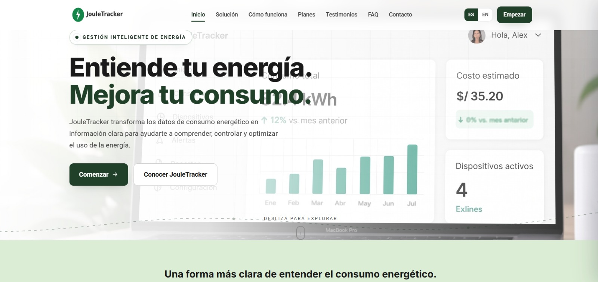

**Figura:** Sección principal de la Landing Page de JouleTracker con la propuesta de valor de la plataforma.

#### Beneficios de JouleTracker

En esta sección se presentan los principales beneficios que ofrece JouleTracker para el monitoreo y gestión del consumo energético de hogares y pequeños negocios.

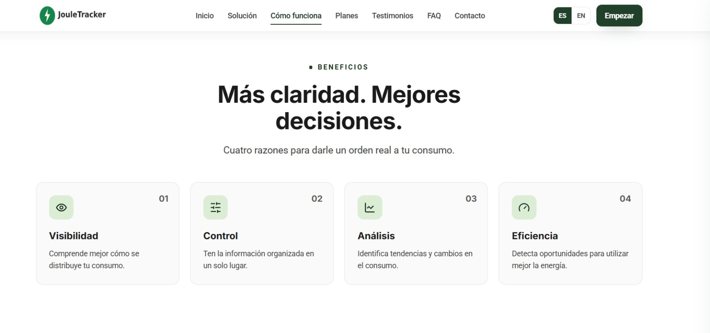

**Figura:** Visualización de los principales beneficios de JouleTracker.

#### Funcionamiento de JouleTracker

La siguiente evidencia muestra la sección destinada a explicar de manera sencilla cómo funciona JouleTracker y cómo la plataforma permite realizar el monitoreo del consumo energético.

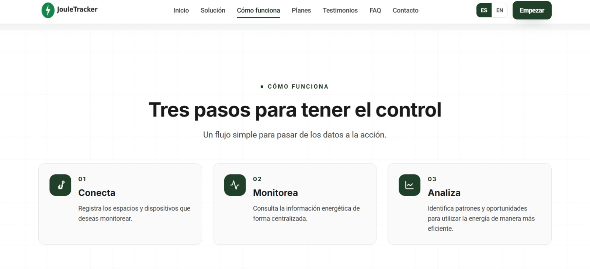

**Figura:** Explicación del funcionamiento de la plataforma JouleTracker.

#### Funcionalidades principales

En esta sección se muestran las funcionalidades principales de JouleTracker, orientadas al monitoreo del consumo energético, visualización de información y gestión de los datos obtenidos.

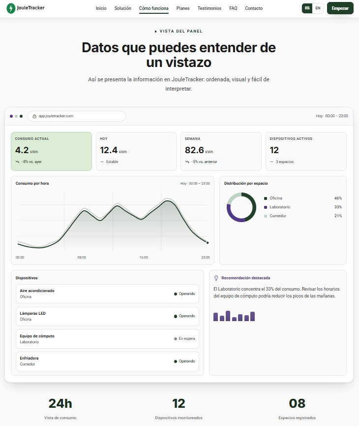

**Figura:** Visualización de las funcionalidades principales de JouleTracker.

#### Planes y costos de JouleTracker

La siguiente captura muestra la sección de planes de JouleTracker, donde se presentan las diferentes opciones disponibles para los usuarios. Cada plan cuenta con un precio mensual y características diferenciadas según las necesidades de monitoreo y análisis del consumo energético.

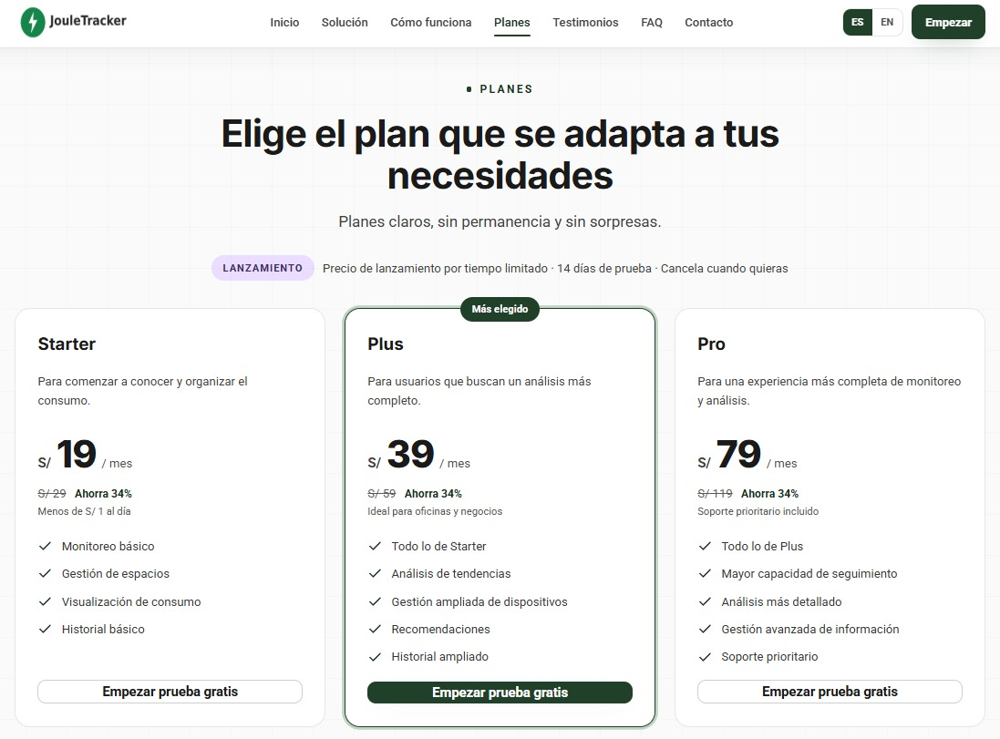

**Figura:** Visualización de los planes de suscripción y costos mensuales de JouleTracker.

#### Versión en inglés de la Landing Page

La siguiente captura evidencia la disponibilidad de la Landing Page de JouleTracker en idioma inglés, permitiendo que la información sobre la plataforma, sus beneficios y funcionalidades pueda ser presentada a usuarios que utilizan este idioma.

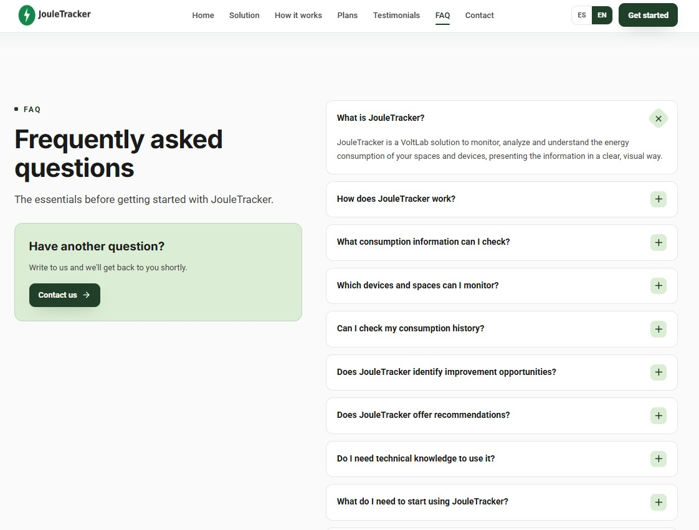

**Figura:** Visualización de la Landing Page de JouleTracker en idioma inglés.

#### Evidencia del despliegue

La Landing Page de JouleTracker fue desplegada para permitir su visualización y validación durante el Sprint Review.

**Enlace de la página desplegada:** https://jouletracker.github.io/JouleTracker-LandingPage/

**Enlace del video de ejecución:** https://drive.google.com/file/d/1v6G61TiA350A7FiNq-jFrFq6u096fupr/view?usp=sharing

### 5.2.1.6. Services Documentation Evidence for Sprint Review.

Durante el Sprint 1, el alcance del proyecto estuvo enfocado exclusivamente en el diseño, maquetación y despliegue de la Landing Page promocional. Al tratarse de un sitio web de contenido estático desarrollado con HTML5, CSS3 y JavaScript puro (Vanilla JS), la arquitectura actual no requiere interacción con bases de datos ni procesamiento del lado del servidor.

Por consiguiente, en esta iteración inicial no se han implementado controladores, repositorios ni servicios de aplicación, motivo por el cual no se genera documentación técnica de endpoints mediante Swagger u OpenAPI. La especificación técnica de los servicios web (Backend API) se documentará en el próximo sprint correspondiente al desarrollo del Core Domain.

### 5.2.1.7. Software Deployment Evidence for Sprint Review.
La evidencia del despliegue de la Landing Page durante el Sprint se mostrará a continuación, el despliegue se realizará en GitHub Pages.

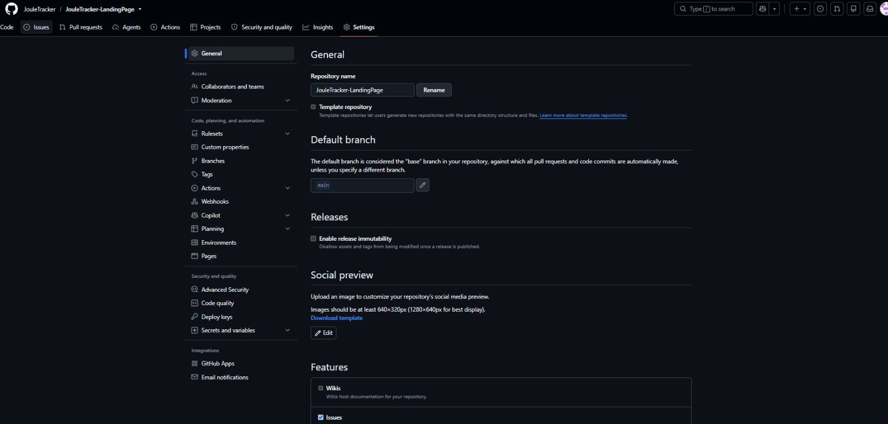

Revisamos que el repositorio esté en público:

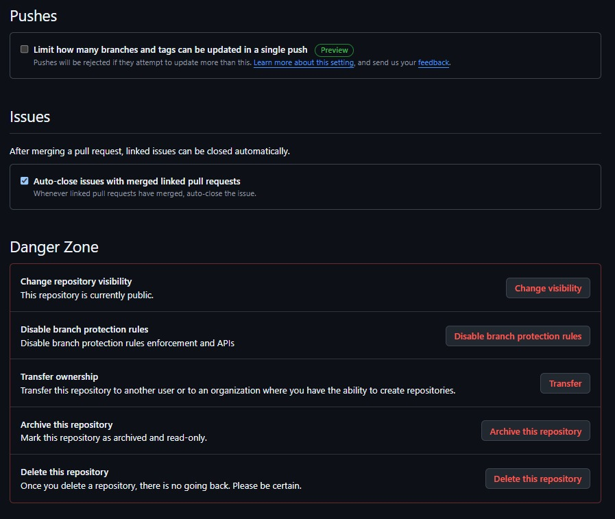


Nos dirigimos a la seccion de deploy, y selecionamos la rama main:

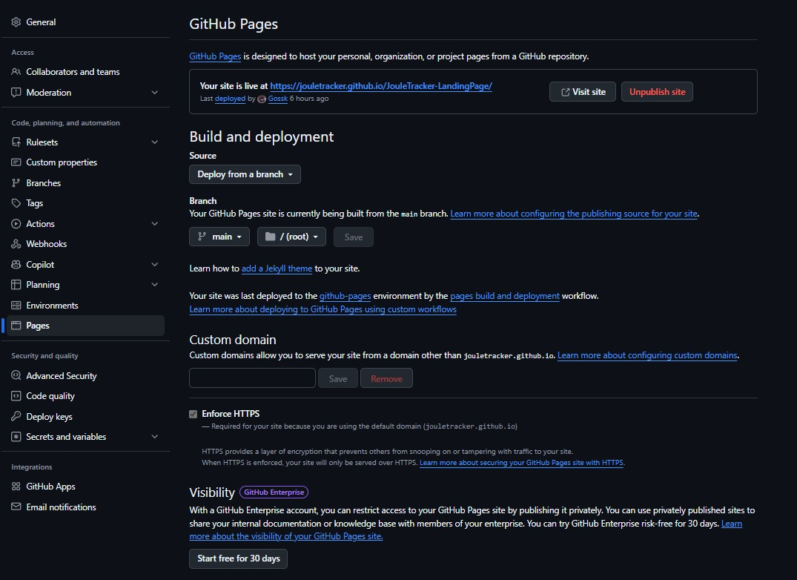


Luego de unos minutos, el deploy se realizara correctamente:

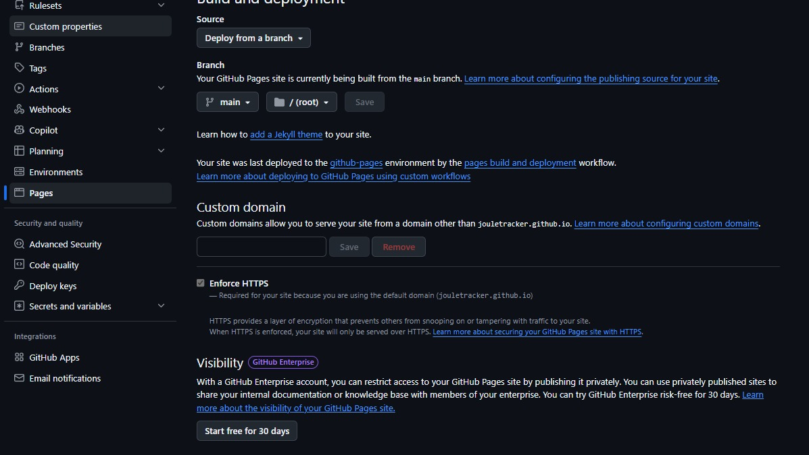

### 5.2.1.8. Team Collaboration Insights during Sprint.

Durante el Sprint 1, VoltLab mantuvo una participación activa en el desarrollo de JouleTracker, distribuyendo las responsabilidades entre los integrantes de acuerdo con las actividades asignadas.

Para evidenciar la colaboración del equipo se utilizaron las métricas proporcionadas por GitHub Insights, las cuales permiten visualizar la cantidad de commits realizados, la participación de los colaboradores y la evolución de las contribuciones dentro del repositorio.

Las siguientes capturas muestran la actividad registrada por los integrantes durante el desarrollo del proyecto.

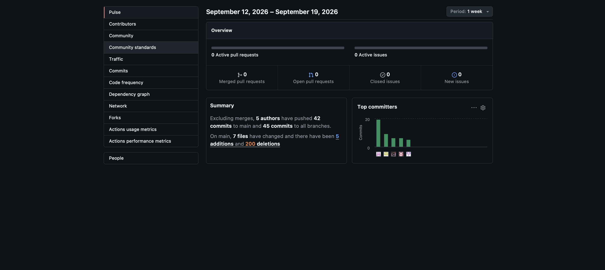

**Figura2:** Métricas generales de contribución del equipo obtenidas mediante GitHub Insights.


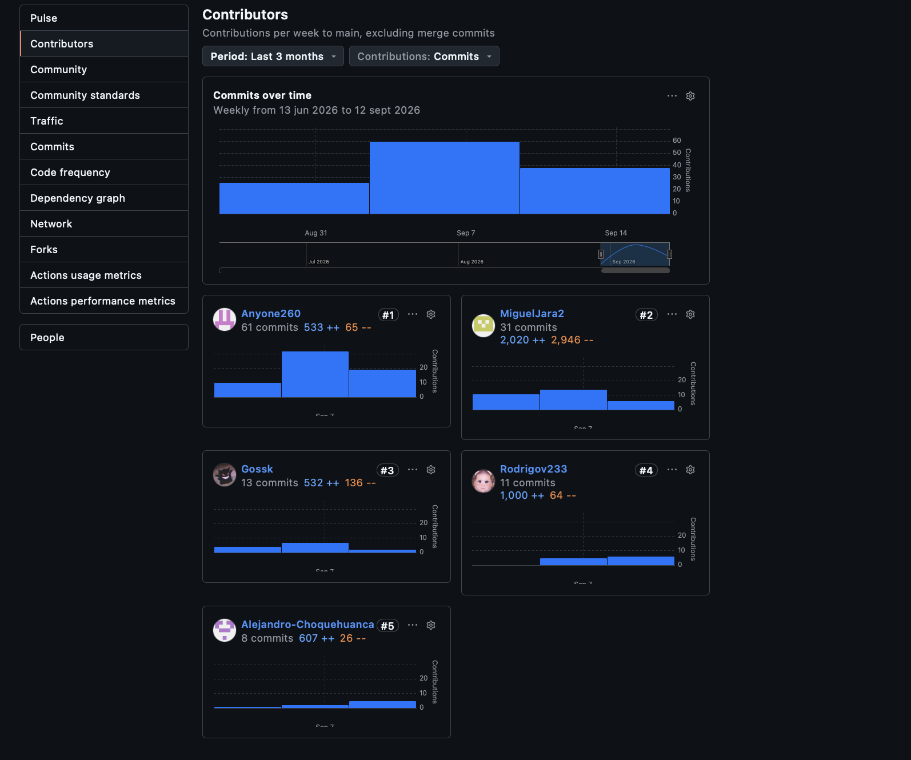

**Figura 2:** Detalle de la participación y commits realizados por los colaboradores del proyecto.

Estas métricas permiten evidenciar el trabajo colaborativo desarrollado durante el sprint y observar la participación de los diferentes integrantes en la evolución del proyecto JouleTracker.

### 5.2.2. Sprint 2

En el Sprint 2, como equipo nos centramos en el desarrollo del frontend web de JouleTracker (Single-Page Application), el cual será la interfaz principal de nuestra plataforma mediante la cual los usuarios (jefes de hogar y administradores de pequeños negocios) podrán monitorear y gestionar su consumo eléctrico en tiempo real. Se desarrollaron los dashboards y módulos necesarios para la gestión de sensores IoT, visualización de métricas energéticas, configuración de límites, alertas de sobrecosto y administración de perfiles.

#### 5.2.2.1. Sprint Planning 2

| Campo | Valor |
|---|---|
| Sprint # | 2 |
| Date | 02-10-2026 |
| Time | 14:00 |
| Location | Virtual, Discord |
| Prepared by | Alejandro Samir Choquehuanca Vasquez |
| Attendees | Alejandro Samir Choquehuanca Vasquez, Miguel Angel Jara Espinoza, Miguel Angel Vidal Castro, Mijail Alexander Matihues Quevedo, Rodrigo Velasquez Velasquez |
| Sprint 1 Review Summary | En el Sprint 1, el equipo se enfocó en el desarrollo y despliegue de la Landing Page de JouleTracker. Con ello, se logró configurar el entorno de trabajo, establecer los requerimientos principales del sistema, la guía de estilo web/mobile, así como el diseño y despliegue del sitio promocional en GitHub Pages. Por otro lado, el profesor a cargo brindó feedback positivo respecto a la propuesta de valor visual y sugirió afinar la trazabilidad de los IDs en la documentación. |
| Sprint 1 Retrospective Summary | Durante el Sprint 1, surgieron ligeras dificultades relacionadas con la sincronización de ramas de trabajo y el ajuste de tiempos en la maquetación responsive. Sin embargo, se logró entregar el sprint de manera completa, desplegando la Landing Page funcional y manteniendo una calidad aceptable en los entregables. |
| Sprint 2 Goal | Nuestro enfoque en este sprint es desarrollar e implementar la interfaz del frontend web de JouleTracker mediante dashboards funcionales para usuarios residenciales y comerciales, permitiendo la visualización de consumo en tiempo real, histórico, gestión de sensores IoT y configuración de alertas. Además, se espera implementar la interfaz base correspondiente a cada Bounded Context del dominio. |
| Sprint 2 Velocity | Límite de 35 SP |
| Sum of Story Points | 35 SP |

#### 5.2.2.2. Aspect Leaders and Collaborators

Durante el Sprint 2, el equipo se enfocó principalmente en el desarrollo del frontend web de JouleTracker, priorizando la interfaz y las funcionalidades principales de la plataforma. Los principales aspectos considerados en este sprint incluyen el desarrollo de todos los Bounded Contexts identificados en el diseño arquitectónico:

* **Identity & Access Management Bounded Context:** Encargado de gestionar la autenticación, inicio de sesión, registro de usuarios, verificación de cuentas y seguridad de acceso a la plataforma.
* **IoT Sensor & Telemetry Bounded Context:** Encargado de registrar, configurar, desvincular sensores IoT y recibir las lecturas telemétricas del consumo eléctrico.
* **Dashboard & Energy Analytics Bounded Context:** Encargado de procesar y presentar el consumo actual, consumo diario, métricas por sensor y resúmenes gráficos en el panel principal.
* **Alerting & Optimization Bounded Context:** Encargado de gestionar los límites de consumo, metas mensuales, generación de alertas preventivas/críticas y recomendaciones de ahorro.
* **Business Energy Management Bounded Context:** Encargado de organizar el establecimiento en áreas, asociar sensores por zonas y comparar el consumo eléctrico entre áreas para pequeños negocios.
* **User Profile & History Bounded Context:** Encargado de la gestión de datos personales, historial de consumo con filtros por fecha y cambio de planes de suscripción.
* **Shared Bounded Context:** Contiene componentes visuales comunes, layouts responsive, reutilizables y estilos globales que son utilizados por múltiples módulos del sistema.

| Team Member | GitHub username | Identity & Access BC / User Profile BC | IoT Sensor & Telemetry BC | Dashboard & Energy Analytics BC | Alerting & Optimization BC | Business Energy Management BC / Shared BC |
|---|---|:---:|:---:|:---:|:---:|:---:|
| Choquehuanca Vasquez, Alejandro Samir | ascv.dev | L | C | C | - | C |
| Jara Espinoza, Miguel Angel | MiguelJara2 | C | L | C | C | - |
| Vidal Castro, Miguel Angel | Gossk | - | C | L | C | C |
| Matihues Quevedo, Mijail Alexander | Anyone260 | C | - | C | L | C |
| Rodrigo Velasquez Velasquez | Rodrigov233 | C | C | - | C | L |

#### 5.2.2.3. Sprint Backlog 2

| US Id | US Title | Task Id | Task Title | Description | Estimation (Hours) | Assigned To | Status |
|---|---|---|---|---|:---:|---|:---:|
| US-01 | Registro de usuario | T10 | Formulario de registro frontend | Construir la vista y validación de campos para el registro de nuevos usuarios. | 4 | Choquehuanca Vasquez, Alejandro Samir | Done |
| US-02 | Inicio de sesión | T11 | Pantalla de Login | Diseñar e implementar el formulario de acceso seguro a la plataforma. | 3 | Choquehuanca Vasquez, Alejandro Samir | Done |
| US-11 | Registro de sensor IoT | T12 | Formulario de vinculación de sensores | Diseñar la interfaz para ingresar identificadores de nuevos dispositivos IoT. | 3 | Jara Espinoza, Miguel Angel | Done |
| US-12 | Configuración de sensor | T13 | Panel de configuración de zona | Crear la vista para asignar nombre y ubicación a cada sensor registrado. | 2 | Jara Espinoza, Miguel Angel | Done |
| US-16 | Visualización del Dashboard | T14 | Maquetación del layout del Dashboard | Estructurar el panel principal con tarjetas de métricas e indicadores. | 5 | Vidal Castro, Miguel Angel | Done |
| US-17 | Visualización del consumo actual | T15 | Componente de lectura en tiempo real | Implementar el medidor visual de potencia (kW/kWh) actual. | 4 | Vidal Castro, Miguel Angel | Done |
| US-18 | Visualización del consumo diario | T16 | Gráfico de consumo diario acumulado | Integrar gráfico de barras para consultar la energía consumida en el día. | 4 | Vidal Castro, Miguel Angel | Done |
| US-26 | Configuración de límite de consumo | T17 | Interfaz de ajuste de umbrales | Crear controles para establecer límites de consumo máximo permitido. | 3 | Matihues Quevedo, Mijail Alexander | Done |
| US-27 | Alerta por exceso de consumo | T18 | Componente de notificaciones y alertas | Implementar banners y tarjetas de aviso visual ante excesos de potencia. | 3 | Matihues Quevedo, Mijail Alexander | Done |
| US-31 | Registro de áreas del negocio | T19 | Vista de administración de áreas MYPE | Construir el módulo para registrar y listar las zonas físicas del negocio. | 3 | Rodrigo Velasquez Velasquez | Done |
| US-33 | Consumo eléctrico por área | T20 | Módulo de análisis por zonas | Desarrollar la vista comparativa de consumo energético entre áreas. | 4 | Rodrigo Velasquez Velasquez | Done |

#### 5.2.2.4. Development Evidence for Sprint Review

Durante el Sprint 2, el avance del desarrollo del frontend fue gestionado de manera transparente a través del tablero de trabajo en Jira, permitiendo realizar el seguimiento continuo de cada tarea desde su estado inicial hasta su culminación exitosa:
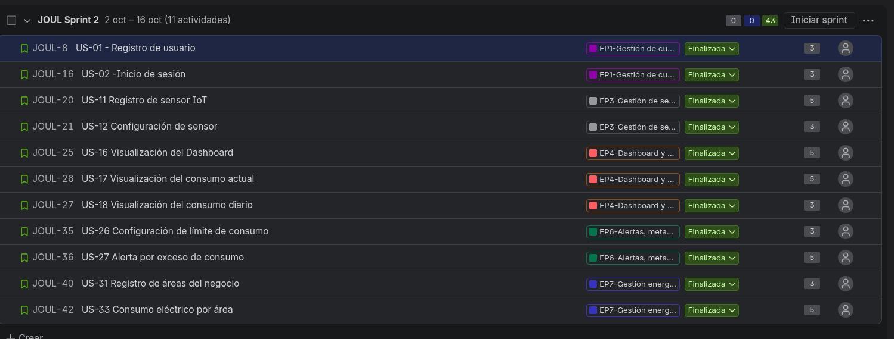

**Figura:** Vista del tablero Kanban en Jira correspondiente a la ejecución de tareas del Sprint 2.
A nivel de código fuente, los integrantes de VoltLab registraron sus avances mediante commits organizados bajo la convención de *Conventional Commits* en el repositorio oficial del Frontend:

| Repository | Branch | Commit Id | Commit Message | Commit Message Body | Committed on (Date) |
|---|---|---|---|---|:---:|
| Frontend | feature/auth | b9a2c1d | feat: implement user login and registration forms | Creación de componentes UI para inicio de sesión y registro con validaciones. | 03/10/2026 |
| Frontend | feature/sensors | 4c8e1f2 | feat: add IoT sensor registration and config views | Implementación de vistas para vinculación y renombrado de sensores. | 05/10/2026 |
| Frontend | feature/dashboard | 7d3a9e0 | feat: build main energy dashboard layout and metrics | Estructuración del dashboard responsive con indicadores principales. | 07/10/2026 |
| Frontend | feature/dashboard | e1f4b8a | feat: integrate real-time power consumption charts | Incorporación de componentes de gráficos para telemetría en tiempo real. | 08/10/2026 |
| Frontend | feature/alerts | 2a6c9d3 | feat: implement consumption limit settings and alerts | Desarrollo del módulo de configuración de umbrales y tarjetas de alerta. | 10/10/2026 |
| Frontend | develop | 8f1e5b4 | Merge pull request #3 from feature/dashboard | Integración del módulo de dashboard a la rama develop. | 11/10/2026 |
| Frontend | feature/mype | 3c9d2e1 | feat: add business areas management and zone comparison | Maquetación del módulo de gestión y comparación de áreas para PYMEs. | 12/10/2026 |
| Frontend | develop | a7f8c2b | refactor: update shared layout and navigation components | Ajustes visuales en la barra de navegación lateral y estilos globales. | 13/10/2026 |
| Frontend | develop | d4e9a1f | fix(api): connect dashboard components to mock telemetry service | Conexión del dashboard con servicios de datos simulados para prueba. | 14/10/2026 |
| Frontend | main | 5b2c8e9 | Merge branch 'develop' into main for release | Preparación de la versión estable del Frontend para revisión del Sprint 2. | 15/10/2026 |

#### 5.2.2.5. Execution Evidence for Sprint Review

En esta sección se presentan las capturas de pantalla de la aplicación web funcional correspondiente al desarrollo del Sprint 2 de JouleTracker:

##### Dashboard Principal de Consumo
Visualización del panel de control donde el usuario puede consultar su consumo eléctrico en tiempo real, consumo acumulado del día e indicadores económicos principales.

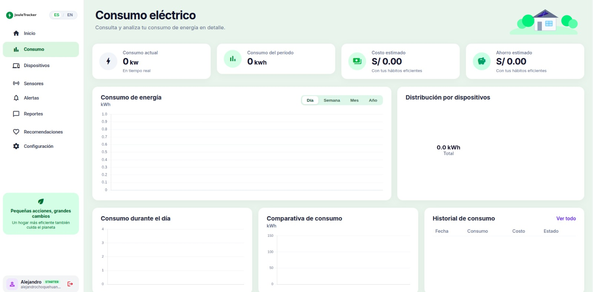

**Figura:** Vista principal del Dashboard de monitoreo energético en JouleTracker.

##### Gestión de Sensores IoT
Módulo para el registro, nombrado y verificación del estado de conexión de los sensores instalados en el hogar o establecimiento.

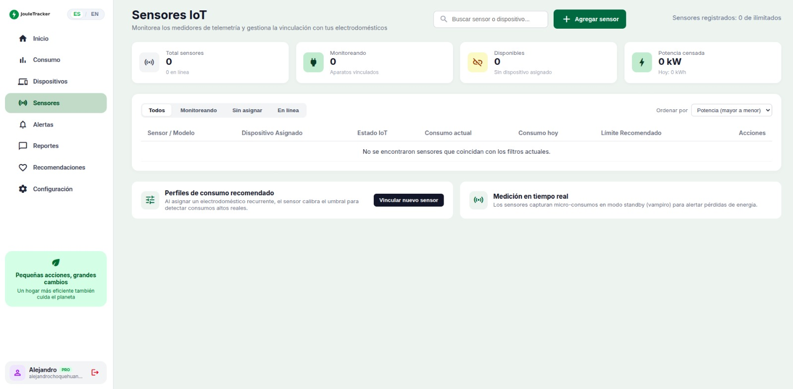

**Figura:** Interfaz para el registro y administración de sensores IoT.

##### Configuración de Alertas y Métricas para PYMEs
Sección dedicada al ajuste de límites de consumo y comparación energética entre las distintas áreas del negocio.

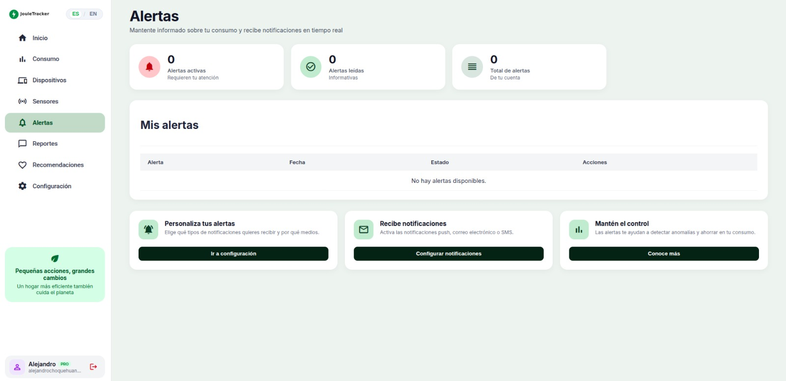

**Figura:** Panel de alertas de sobrecosto y comparación por áreas del negocio.

##### Evidencia del Despliegue y Video de Ejecución
* **Enlace del Frontend desplegado:**  https://jouletracker-app.onrender.com/
* **Enlace del video de demostración:** https://upcedupe-my.sharepoint.com/:v:/g/personal/u202314186_upc_edu_pe/IQA44UOoizuXTKtjNNVSucmHAaF7QsB-ggFVLe-lBus9X34?e=YKwjz8&nav=eyJyZWZlcnJhbEluZm8iOnsicmVmZXJyYWxBcHAiOiJTdHJlYW1XZWJBcHAiLCJyZWZlcnJhbFZpZXciOiJTaGFyZURpYWxvZy1MaW5rIiwicmVmZXJyYWxBcHBQbGF0Zm9ybSI6IldlYiIsInJlZmVycmFsTW9kZSI6InZpZXcifX0%3D

#### 5.2.2.6. Services Documentation Evidence for Sprint Review

Durante el Sprint 2, el equipo se enfocó en el desarrollo del Frontend de la aplicación web (Single-Page Application). La lógica de consumo de datos se conectó mediante adaptadores a servicios simulados (mock APIs) e interfaces de integración preparadas para conectarse con el Backend en la siguiente iteración.

La especificación OpenAPI/Swagger oficial de la API de microservicios (Spring Boot) para los endpoints de telemetría, alertas y perfiles será integrada y documentada en el Sprint 3 con la entrega completa de la arquitectura de backend.

#### 5.2.2.7. Software Deployment Evidence for Sprint Review

El despliegue del Sprint 2 de JouleTracker se realizó en la plataforma **Render**, bajo el workspace del equipo, y se dividió en dos servicios: la aplicación web del Frontend (Single-Page Application) y un servidor de datos simulados (**json-server**) que cumple el rol de API mock mientras se desarrolla el Backend en el Sprint 3. Ambos servicios se alimentan del repositorio oficial `JouleTracker/Frontend` en GitHub (rama `master`).

1. **Despliegue del servidor de datos (json-server):**
    * Se creó el servicio web `jouletracker-api` en Render, con región *Oregon (US West)* y plan gratuito (*Free*), conectado al repositorio `JouleTracker/Frontend`.
    * Se configuró el script de inicio de json-server para el entorno de Render (commit `ae2d041`: *chore: configure json-server start script for render*).
    * Render ejecutó el primer despliegue (*First Deploy*) el 09/10/2026 a las 5:40 a. m. (GMT-5), con una duración de 1 min 04 s. Los logs muestran el servidor escuchando en el puerto 10000 y el mensaje *Your service is live*.
    * Estado final: **Deploy succeeded | Live**.

2. **Configuración de la URL de producción en el Frontend:**
    * Se actualizó la URL base de la API en la aplicación para que apunte al servicio desplegado en Render (commit `27a5e4d`: *chore: set production api url to render*).

3. **Despliegue de la aplicación web (Frontend):**
    * Se creó el servicio `jouletracker-app` en Render, el cual clona el repositorio, instala las dependencias con `npm` (Node.js 24.21.0, 407 paquetes) y publica la aplicación.
    * El primer despliegue se realizó el 09/10/2026 a las 5:53 a. m. (GMT-5), con una duración de 28.7 s.
    * Estado final: **Deploy succeeded | Live**.

4. **Verificación y enlaces públicos de producción:**
    * Aplicación web: https://jouletracker-app.onrender.com/
    * Servidor de datos (json-server): https://jouletracker-api.onrender.com/

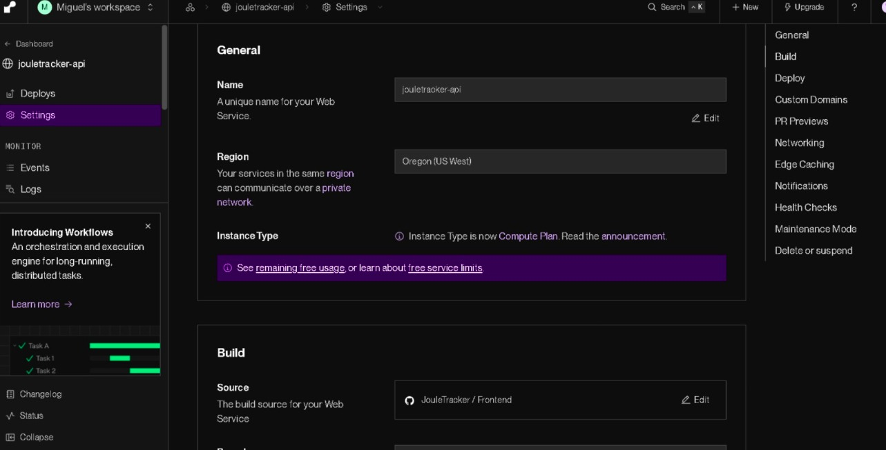

**Figura:** Configuración general del servicio `jouletracker-api` en Render (región, plan y repositorio fuente).

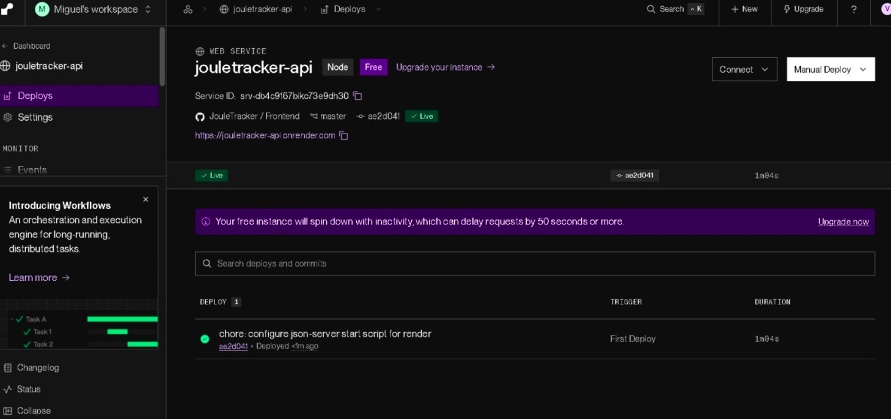

**Figura:** Despliegue exitoso (*Live*) del servidor json-server en Render, con su URL pública.

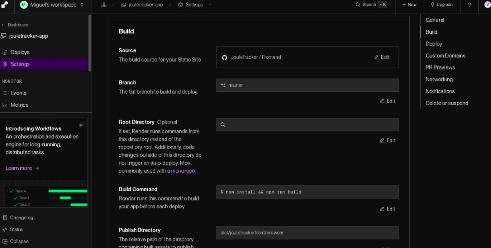

**Figura:** Despliegue exitoso (*Live*) de la aplicación web `jouletracker-app` en Render.

#### 5.2.2.8. Team Collaboration Insights during Sprint

A través de las métricas proporcionadas por GitHub Insights, se registra la actividad continua, distribución de tareas y commits realizados por los integrantes de VoltLab durante el desarrollo del Sprint 2:

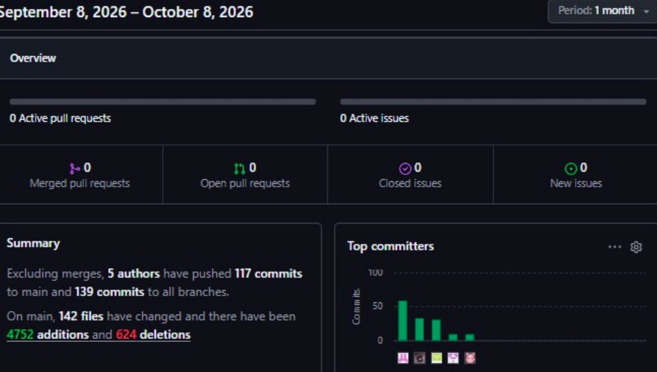

**Figura:** Descripción (Imagen 1 - Resumen general):
El panel general evidencia que, en el período del 8 de septiembre al 8 de octubre de 2026, los 5 integrantes del equipo registraron 117 commits en la rama principal (139 en todas las ramas). Durante este intervalo no se abrieron pull requests ni issues, impactando un total de 142 archivos modificados con 4752 líneas agregadas y 624 eliminadas.

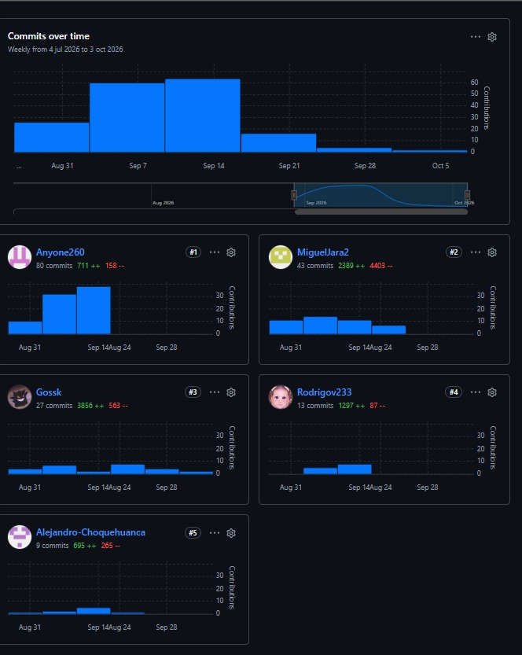

**Figura:**
Descripción (Imagen 2 - Detalle de contribuciones por integrante):
El desglose individual muestra que la mayor concentración de actividad se dio entre las semanas del 7 y 14 de septiembre, con aportes de Anyone260 (80 commits; +711/-158), MiguelJara2 (43 commits; +2389/-4403), Gossk (27 commits; +3856/-563), Rodrigov233 (13 commits; +1297/-87) y Alejandro-Choquehuanca (9 commits; +695/-265), evidenciando la participación de todo el equipo en el desarrollo del código.

### 5.2.3. Sprint 3

Durante el Sprint 3, VoltLab centró sus esfuerzos en la implementación del **Backend API** de JouleTracker (desarrollado en Java con Spring Boot bajo una arquitectura Domain-Driven Design) y en su integración progresiva con la **aplicación web Frontend** (Angular), reemplazando las respuestas simuladas utilizadas durante el Sprint 2 por servicios RESTful reales con persistencia en base de datos y seguridad basada en tokens JWT.

De manera paralela, el equipo ejecutó sesiones de entrevistas de validación con usuarios de ambos segmentos objetivo (hogares urbanos y pequeños negocios), documentó los endpoints implementados mediante Swagger/OpenAPI y actualizó el informe técnico del proyecto junto con las evidencias de cumplimiento del Student Outcome 3.

#### 5.2.3.1. Sprint Planning 3

| Campo | Valor |
|---|---|
| Sprint # | 3 |
| Date | 16-10-2026 |
| Time | 15:00 |
| Location | Virtual, Discord |
| Prepared by | Mijail Alexander Matihues Quevedo |
| Attendees | Alejandro Samir Choquehuanca Vasquez, Miguel Angel Jara Espinoza, Miguel Angel Vidal Castro, Mijail Alexander Matihues Quevedo, Rodrigo Velasquez Velasquez |
| Sprint 2 Review Summary | En el Sprint 2 se implementó y desplegó la Single-Page Application (Frontend) en Render junto con un servidor mock (`json-server`), cubriendo los módulos de autenticación, dashboard de consumo, sensores, alertas, reportes y áreas de negocio. En la revisión se validó el flujo visual completo y se estableció como prioridad para el siguiente sprint la implementación del Backend real en Spring Boot y su integración con el cliente web. |
| Sprint 2 Retrospective Summary | Durante el Sprint 2 se identificó la necesidad de estandarizar los contratos de API antes de conectar el Frontend para evitar retrabajos, así como distribuir mejor la carga de documentación y pruebas funcionales en paralelo al desarrollo técnico. Para el Sprint 3 se acordó definir previamente los endpoints por Bounded Context y mantener actualizado el tablero en Jira y el informe conforme avanzan las entregas. |
| Sprint 3 Goal | Implementar los servicios RESTful centrales del Backend API de JouleTracker (autenticación JWT en IAM, gestión de sensores IoT, ingesta y consulta de lecturas de telemetría y gestión de áreas de negocio MYPE), documentarlos mediante OpenAPI/Swagger, integrarlos con la aplicación web Frontend y validar el producto funcional con usuarios reales de ambos segmentos objetivo. |
| Sprint 3 Velocity | Límite de 36 SP |
| Sum of Story Points | 36 SP |

#### 5.2.3.2. Aspect Leaders and Collaborators

En el Sprint 3 se mantuvo la organización por Bounded Contexts y frentes de trabajo, distribuyendo el liderazgo de los servicios Backend, la integración con el Frontend, las entrevistas de validación y la consolidación documental del informe:

* **Identity & Access Management (IAM) & Validation / Frontend Support:** Implementación del registro (`sign-up`), inicio de sesión (`sign-in`), cifrado con BCrypt y emisión/validación de tokens Bearer JWT, además de apoyo en vistas Frontend y ejecución de entrevistas de validación.
* **Device Management (Backend):** Implementación de endpoints para el registro, asociación al usuario autenticado, listado y verificación de estado de conexión de sensores IoT.
* **Energy Monitoring & Telemetry (Backend):** Implementación del módulo de ingesta y persistencia de lecturas eléctricas (kW, kWh, voltaje y corriente) enviadas por los dispositivos.
* **Consumption Analytics & Dashboard Integration (Backend / Frontend / Documentación):** Consulta de la última medición en tiempo real para alimentar el Dashboard, consolidación de las secciones del Sprint 3 y elaboración del Student Outcome 3.
* **Business Energy Management & Report Consolidation (Backend / Informe):** Gestión de zonas físicas para pequeños negocios (MYPE), integración de flujos y actualización integral del Project Report.

| Team Member | GitHub username | Identity & Access BC (IAM) / Frontend & Entrevistas | Device Management BC (Backend) | Energy Monitoring BC (Backend) | Analytics & Dashboard Integration / Docs | Business Energy Management BC / Report Update |
|---|---|:---:|:---:|:---:|:---:|:---:|
| Choquehuanca Vasquez, Alejandro Samir | ascv.dev | L | C | - | C | - |
| Jara Espinoza, Miguel Angel | MiguelJara2 | C | L | C | - | C |
| Vidal Castro, Miguel Angel | Gossk | C | C | L | C | - |
| Matihues Quevedo, Mijail Alexander | Anyone260 | - | - | C | L | C |
| Rodrigo Velasquez Velasquez | Rodrigov233 | - | - | - | C | L |

#### 5.2.3.3. Sprint Backlog 3

| TS / US Id | Title | Bounded Context | Task Id | Task Title | Description | Estimation (Hours) | Assigned To | Status |
|---|---|---|---:|---|---|---:|---|:---:|
| TS-01 | Register User | Identity & Access Management (IAM) | T21 | Endpoint de registro con BCrypt | Implementar `POST /api/v1/authentication/sign-up` con hashing BCrypt, validación de unicidad de correo y conexión con el formulario de registro en Frontend. | 5 | Choquehuanca Vasquez, Alejandro Samir | Done |
| TS-02 | Login User & JWT Auth | Identity & Access Management (IAM) | T22 | Endpoint de login y filtro JWT | Implementar `POST /api/v1/authentication/sign-in` con generación/validación de tokens Bearer JWT y actualización del interceptor de autenticación en Frontend. | 5 | Choquehuanca Vasquez, Alejandro Samir | Done |
| TS-05 | Register Sensor IoT | Device Management | T23 | Endpoint de registro de sensores | Implementar `POST /api/v1/sensors` para registrar y asociar sensores IoT al usuario autenticado con validaciones de dominio. | 5 | Jara Espinoza, Miguel Angel | Done |
| TS-08 | Get Sensor Status & List | Device Management | T24 | Endpoints de listado y estado de sensores | Implementar `GET /api/v1/sensors` y `GET /api/v1/sensors/{id}` para listar sensores del usuario y verificar su estado de conexión. | 3 | Jara Espinoza, Miguel Angel | Done |
| TS-07 | Receive Energy Reading | Energy Monitoring | T25 | Endpoint de ingesta de telemetría | Implementar `POST /api/v1/telemetry/readings` para recibir y persistir lecturas de potencia (kW, kWh, voltaje, corriente) asociadas a cada sensor. | 8 | Vidal Castro, Miguel Angel | Done |
| TS-10 | Get Latest Reading | Energy Monitoring / Analytics | T26 | Endpoint de última lectura e integración en Dashboard | Implementar `GET /api/v1/sensors/{id}/readings/latest` para entregar la última medición en tiempo real al Dashboard y documentar el avance del Sprint 3 y Student Outcome. | 5 | Matihues Quevedo, Mijail Alexander | Done |
| TS-16 | Manage Business Areas | Business Energy Management | T27 | Endpoints de áreas de negocio y actualización de informe | Implementar `POST /api/v1/business-areas` y `GET /api/v1/business-areas` para registrar y listar zonas físicas MYPE, además de apoyar en la actualización del informe y Sprint 3. | 5 | Velasquez Velasquez, Rodrigo | Done ||

#### 5.2.3.4. Development Evidence for Sprint Review

El seguimiento de las tareas planificadas para el Sprint 3 se gestionó mediante el tablero Kanban en Jira Software Cloud, permitiendo verificar el avance de las historias técnicas de Backend y las tareas de integración con el Frontend hasta su estado final (*Done*).

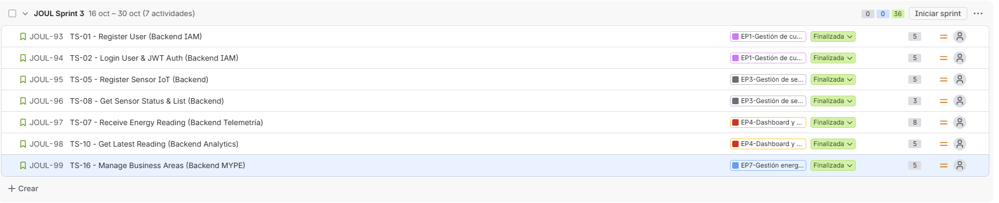

A nivel de repositorios, los avances fueron registrados siguiendo el flujo de ramas de GitFlow y el estándar *Conventional Commits*:

 | Repository | Branch | Commit Id | Commit Message | Commit Message Body | Committed on (Date) |
|---|---|---|---|---|:---:|
| Backend | feature/iam-jwt | `1ddcbf743daf4512a0a218cce9c58f5696efc058` | `feat(iam): implement sign-up and sign-in endpoints with JWT` | Implementación de registro con BCrypt, autenticación y emisión de tokens Bearer JWT (`TS-01`, `TS-02`). | `11/11/2026` |
| Backend | feature/devices-context | `8e5f60b0e52b4649ec204b0f31c8d629095fcee8` | `feat(context): add sensor registration and status endpoints` | Creación de `POST /api/v1/sensors`, `GET /api/v1/sensors` y `GET /api/v1/sensors/{id}` (`TS-05`, `TS-08`). | `11/11/2026` |
| Backend | feature/energy-monitoring | `fc99f46327755035f97938bc158be1a83c6a0de9` | `feat(telemetry): implement energy reading ingestion endpoint` | Implementación de `POST /api/v1/telemetry/readings` para persistencia de kW, kWh, voltaje y corriente (`TS-07`). | `12/11/2026` |
| Backend | feature/energy-monitoring | `4fbb243ff0f82e2fe6e9b1d2bf6102cf744c1cb0` | `feat(analytics): add latest sensor reading query endpoint` | Implementación de `GET /api/v1/sensors/{id}/readings/latest` para consulta en tiempo real (`TS-10`). | `12/11/2026` |
| Backend | feature/business-energy-management | `8933833596f3029e2b36c3b56b8b171286df77f6` | `feat(business): add business areas CRUD endpoints` | Implementación de `POST /api/v1/business-areas` y `GET /api/v1/business-areas` para el segmento MYPE (`TS-16`). | `10/11/2026` |
| Frontend | feature/api-integration | `11bd0a4c01566e3ec7c7cec06d4956c21afb1427` | `feat(auth): connect login and register forms to backend JWT API` | Integración del módulo IAM del Frontend con los endpoints reales y manejo de Bearer Token. | `13/11/2026` |
| Frontend | feature/dashboard-live | `07e3f9d7a9d0adcf5dba85c27b021b0566c5c571` | `feat(dashboard): connect real-time telemetry and sensor views to backend` | Consumo de endpoints de sensores, últimas lecturas y áreas de negocio desde la SPA en Angular. | `4/10/2026` |
| JouleTracker | feature/chapter5-sprint3 | `ff2495bc3706faf7ae90b24656d6ffd0f574d6b8` | `docs(chapter5): add Sprint 3 documentation and Student Outcome updates` | Redacción de Sprint Planning 3, Sprint Backlog 3, evidencias y actualización de versiones del informe. | `15/11/2026` |

#### 5.2.3.5. Execution Evidence for Sprint Review

En esta sección se presentan las evidencias de ejecución del sistema JouleTracker integrando la interfaz web Frontend con los servicios RESTful del Backend desarrollados durante el Sprint 3.

##### Autenticación y Control de Acceso (IAM)
Registro e inicio de sesión de usuarios validados contra el Backend mediante hashing BCrypt y tokens Bearer JWT.

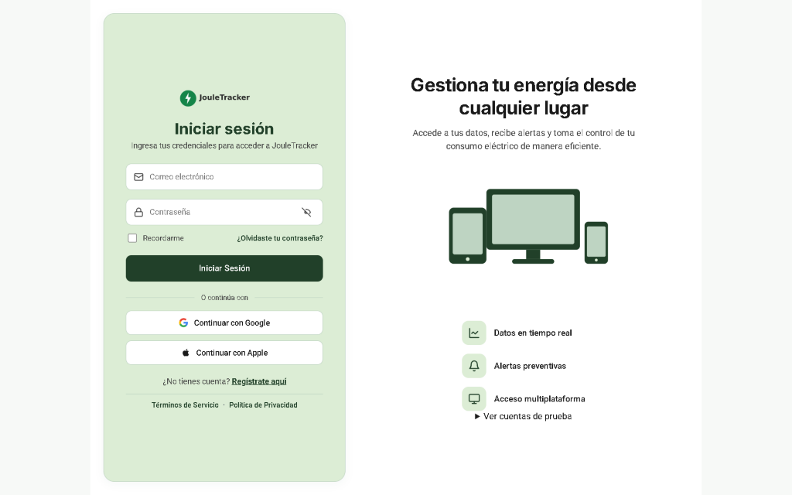

**Figura:** Flujo de inicio de sesión conectado a los endpoints de IAM.

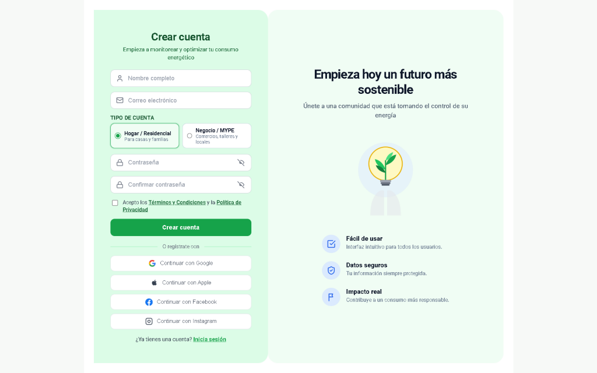

**Figura:** Flujo de registro con selector de tipo de cuenta (`Hogar / Residencial` y `Negocio / MYPE`) conectado a IAM.

##### Gestión de Sensores IoT y Áreas de Negocio (MYPE)
Listado, registro y consulta de estado de sensores IoT asociados al usuario, así como la organización por zonas físicas en pequeños negocios.

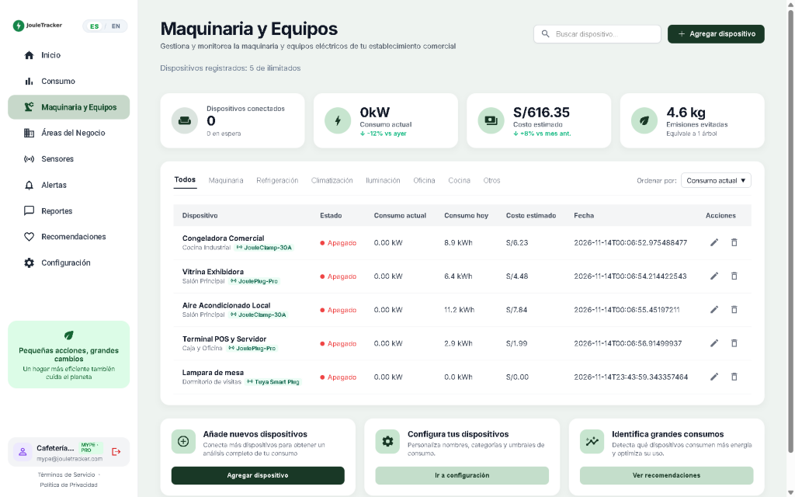

**Figura:** Listado y resumen de maquinaria y equipos registrados en la cuenta MYPE conectados al Backend.

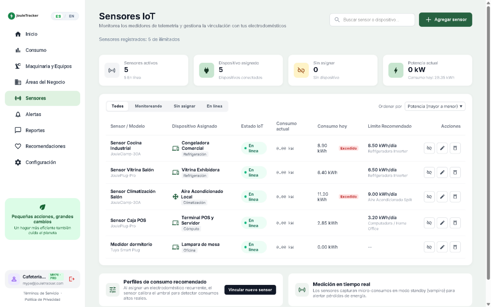

**Figura:** Administración y estado en línea de sensores IoT (`5` sensores activos, límites recomendados y consumo diario) conectados al Backend.

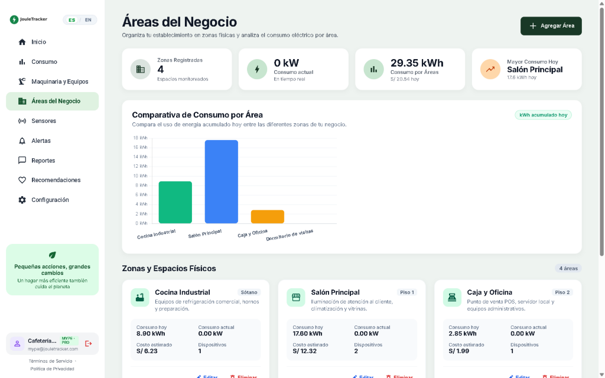

**Figura:** Comparativa de consumo y zonas físicas registradas (`Cocina Industrial`, `Salón Principal`, `Caja y Oficina`) para el segmento MYPE.

##### Dashboard y Última Lectura de Telemetría en Tiempo Real
Visualización en la aplicación web de las lecturas energéticas (kW, kWh, voltaje y corriente) recuperadas directamente desde el Backend API.

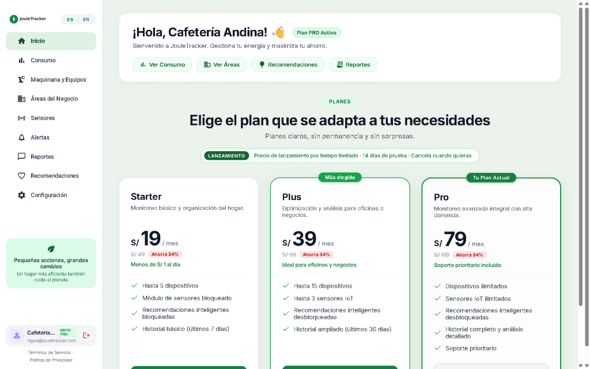

**Figura:** Vista de bienvenida autenticada (`Cafetería Andina`, Plan PRO) con accesos rápidos a módulos y planes.

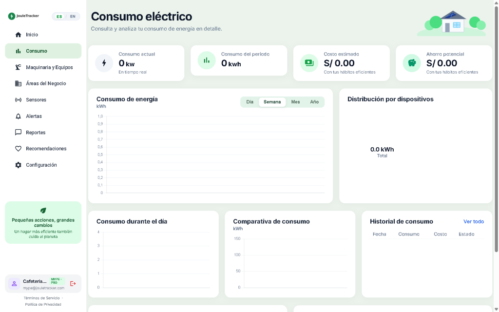

**Figura:** Dashboard de consumo eléctrico (`0.71 kW` en tiempo real, `173.59 kWh` acumulados y distribución por dispositivos) conectado al Backend API en producción.

##### Evidencia del Despliegue y Video de Ejecución
* **Enlace del Frontend desplegado:** https://jouletracker-front.onrender.com/
* **Enlace del Backend API desplegado:** https://jouletracker-api-kmok.onrender.com
* **Enlace de documentación Swagger UI:** https://jouletracker-api-kmok.onrender.com/swagger-ui/index.html
* **Enlace del video de demostración (Sprint 3):** https://www.youtube.com/watch?v=UYQWInpBB8s

#### 5.2.3.6. Services Documentation Evidence for Sprint Review

Durante el Sprint 3 se implementó la documentación técnica interactiva de los servicios RESTful del Backend utilizando **OpenAPI 3 / Swagger (springdoc-openapi)**, permitiendo inspeccionar y probar los contratos de entrada, respuestas HTTP, esquemas JSON y autenticación mediante Bearer JWT.

Los principales endpoints implementados y documentados corresponden a los Bounded Contexts priorizados en el Sprint:

| Bounded Context | Método HTTP | Endpoint | Descripción | Story / TS |
|---|---|---|---|---|
| Identity & Access Management | `POST` | `/api/v1/authentication/sign-up` | Registra un nuevo usuario validando unicidad de correo y cifrando la contraseña con BCrypt. | `TS-01` |
| Identity & Access Management | `POST` | `/api/v1/authentication/sign-in` | Autentica las credenciales del usuario y retorna el token Bearer JWT de acceso. | `TS-02` |
| Device Management | `POST` | `/api/v1/sensors` | Registra un nuevo sensor IoT y lo asocia al usuario autenticado. | `TS-05` |
| Device Management | `GET` | `/api/v1/sensors` | Lista los sensores IoT registrados pertenecientes al usuario autenticado. | `TS-08` |
| Device Management | `GET` | `/api/v1/sensors/{id}` | Obtiene el detalle y estado de conexión de un sensor específico. | `TS-08` |
| Energy Monitoring | `POST` | `/api/v1/telemetry/readings` | Recibe y almacena lecturas de potencia (kW, kWh, voltaje, corriente) enviadas por un sensor. | `TS-07` |
| Energy Monitoring / Analytics | `GET` | `/api/v1/sensors/{id}/readings/latest` | Retorna la lectura de telemetría más reciente registrada para un sensor determinado. | `TS-10` |
| Business Energy Management | `POST` | `/api/v1/business-areas` | Registra una nueva área o zona física de monitoreo para un pequeño negocio. | `TS-16` |
| Business Energy Management | `GET` | `/api/v1/business-areas` | Lista las áreas físicas registradas por el propietario del establecimiento. | `TS-16` |

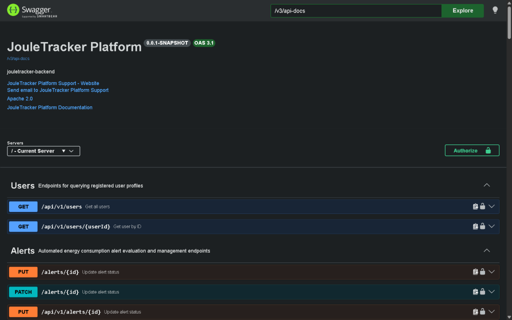

**Figura:** Vista de la interfaz Swagger UI con los endpoints RESTful documentados del Backend de JouleTracker (`/` seleccionado por defecto y botón `Authorize`).

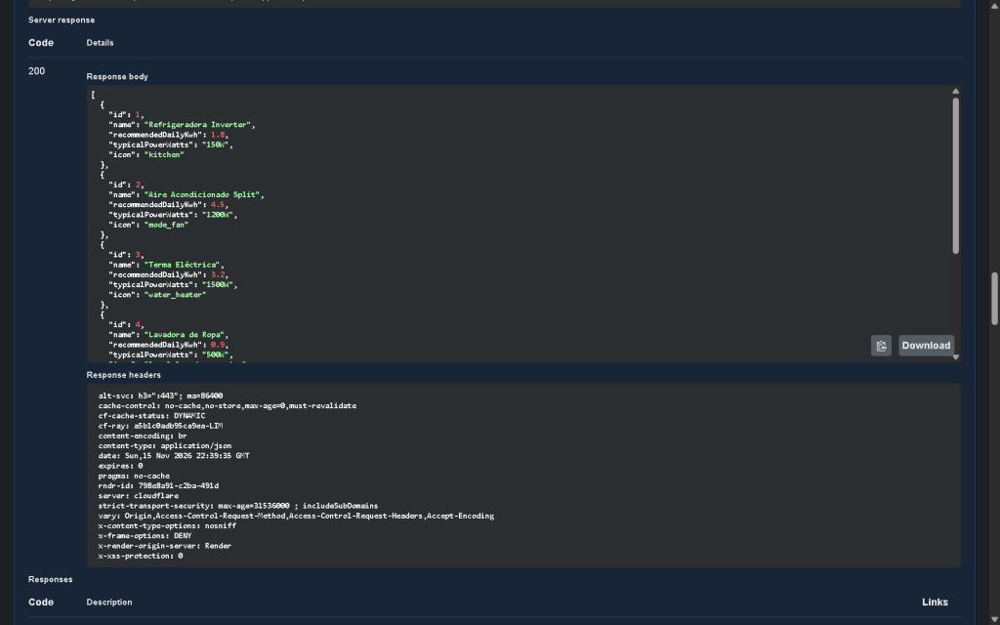

**Figura:** Ejecución en vivo desde Swagger UI (`GET /api/v1/appliance-profiles` con *Try it out*) obteniendo respuesta `200 OK` en JSON desde Render.

#### 5.2.3.7. Software Deployment Evidence for Sprint Review

El despliegue correspondiente al Sprint 3 contempló la publicación del servicio **Backend API** en Spring Boot conectado a su base de datos relacional en la nube y la actualización del **Frontend** en Angular para consumir los endpoints reales de producción en reemplazo del servidor mock anterior.

El flujo de despliegue seguido para esta iteración comprende:
1. **Compilación y empaquetado del Backend API:** Construcción del artefacto Spring Boot (Java) con las variables de entorno configuradas para la conexión a la base de datos, clave secreta de firma JWT y permisos CORS hacia el dominio del Frontend.
2. **Despliegue de la base de datos y servicio web Backend:** Publicación del contenedor/servicio en la plataforma cloud y verificación de disponibilidad de los endpoints mediante Swagger UI.
3. **Actualización de configuración en el Frontend:** Apuntado de la variable `apiBaseUrl` en el entorno de producción hacia la URL del Backend desplegado y redespliegue automático del cliente web.

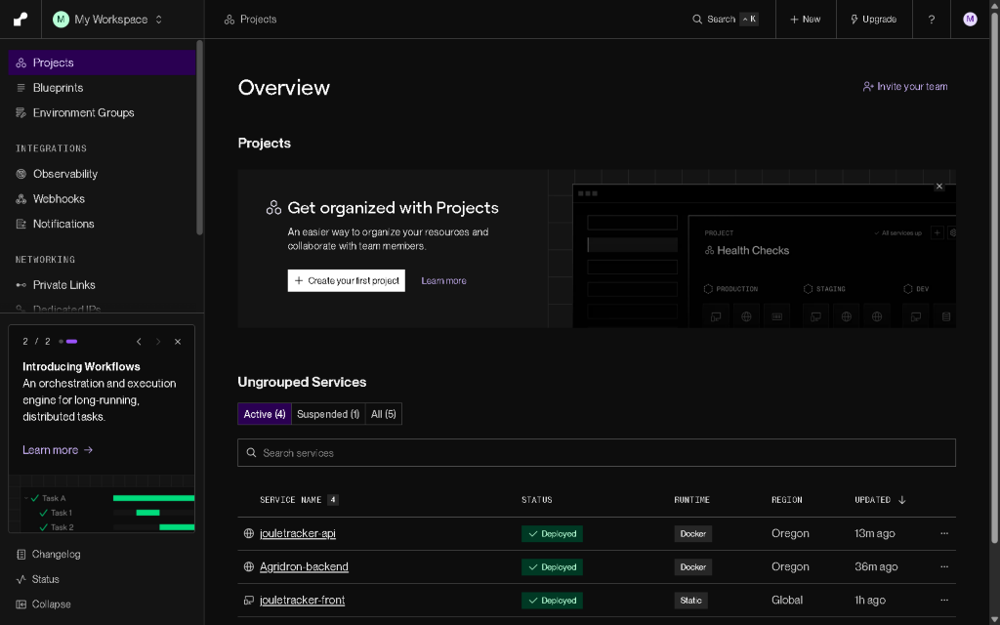

**Figura:** Panel general de servicios activos (`jouletracker-api` en Docker y `jouletracker-front` como sitio estático) en Render.

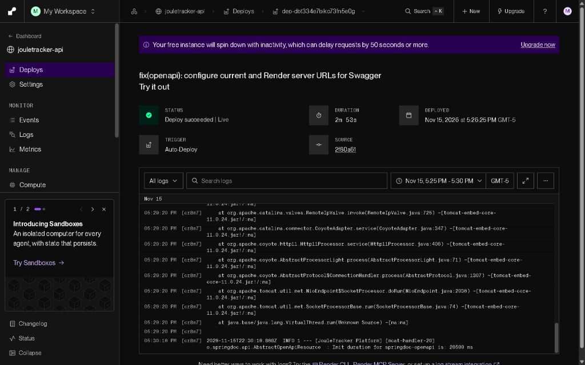

**Figura:** Estado *Live* y logs de despliegue del servicio Backend de JouleTracker (`jouletracker-api`, commit `2f80a61`).

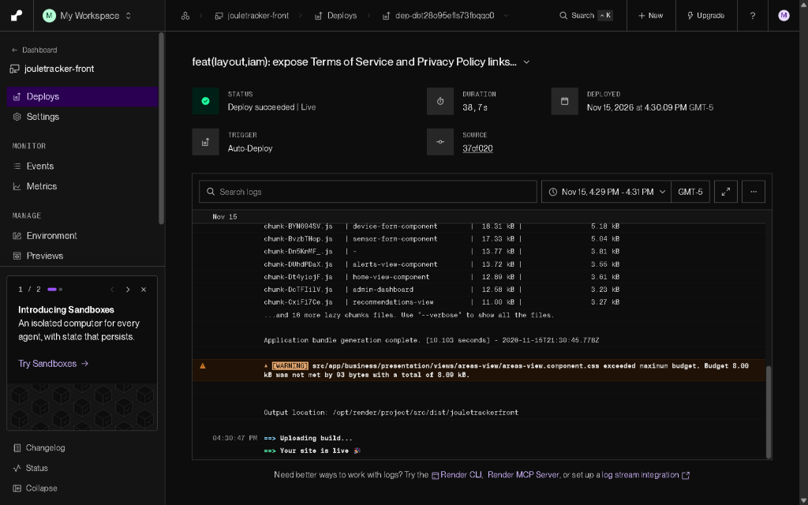

**Figura:** Redespliegue del Frontend conectado a la API de producción del Backend (`jouletracker-front`, commit `37cf020`).

#### 5.2.3.8. Team Collaboration Insights during Sprint

Con el objetivo de evidenciar la participación equitativa y el aporte continuo de todos los integrantes de VoltLab durante el Sprint 3, se recopilan las métricas de colaboración desde GitHub Insights en los repositorios del proyecto (Backend, Frontend y Project Report).

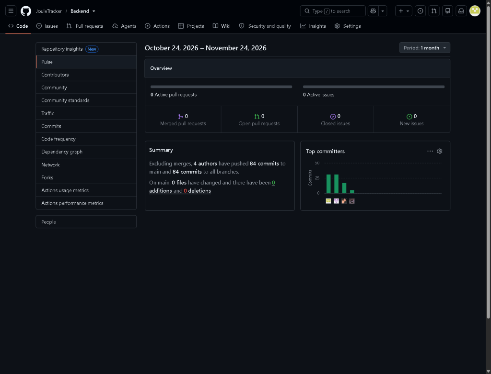

**Figura:** Métricas generales de actividad (*Pulse*) registradas en el repositorio `Backend` durante el Sprint 3.

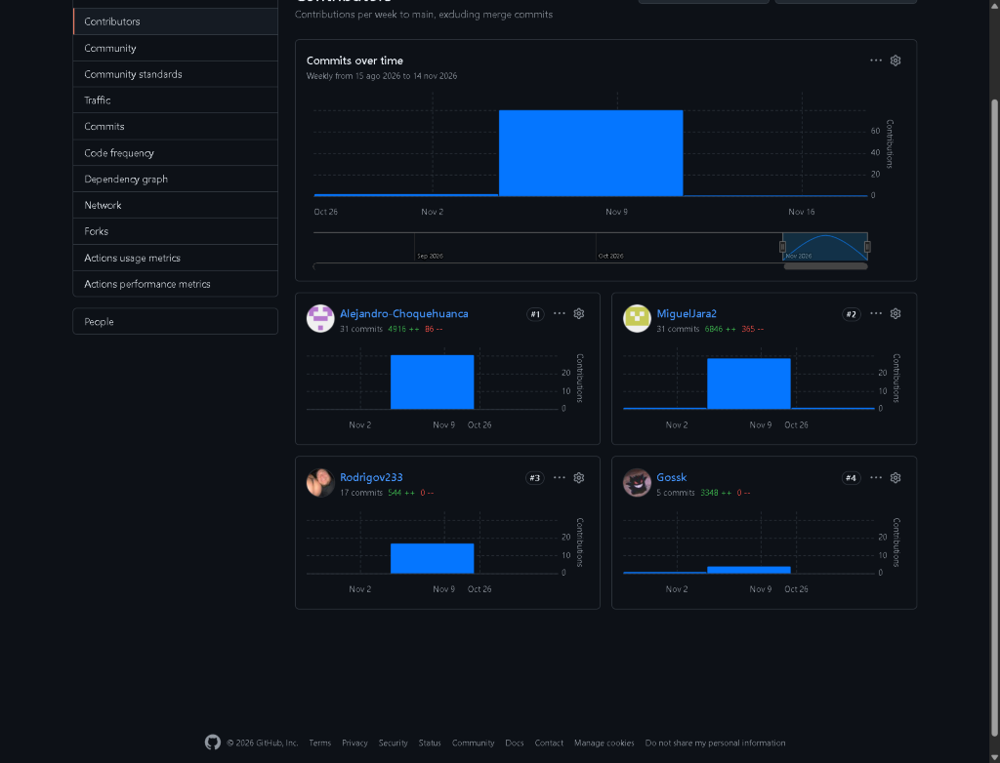

**Figura:** Detalle de contribuciones por integrante en el repositorio `Backend` durante el Sprint 3.

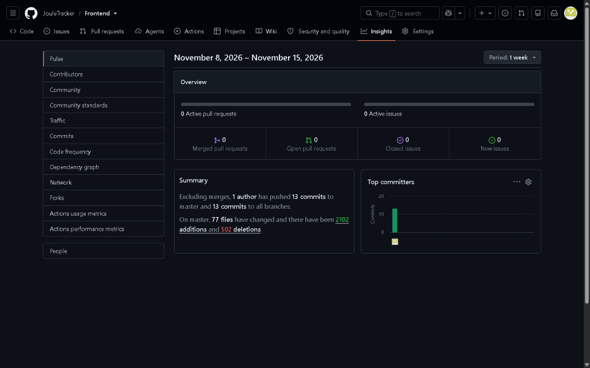

**Figura:** Métricas de actividad (*Pulse*) registradas en el repositorio `Frontend` durante el Sprint 3.

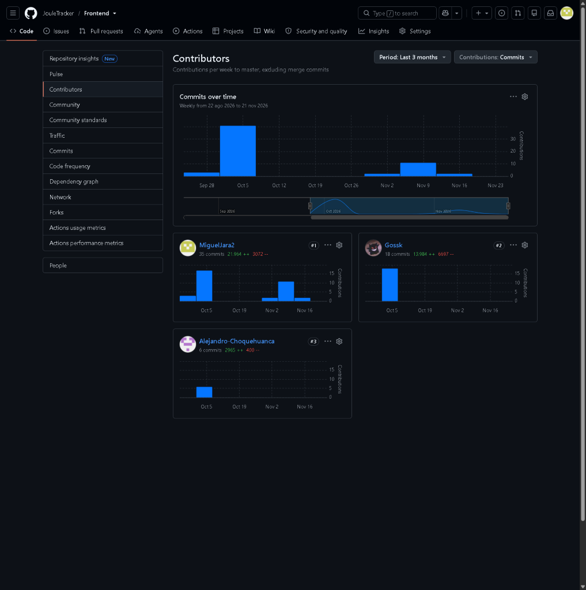

**Figura:** Detalle de contribuciones por integrante en el repositorio `Frontend` durante el Sprint 3.

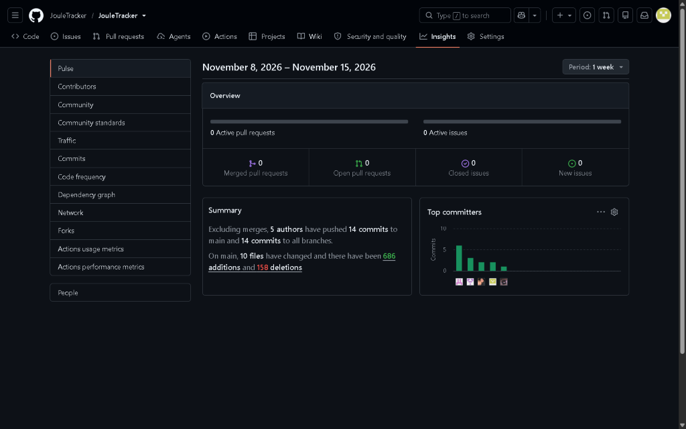

**Figura:** Métricas de actividad (*Pulse*) registradas en el repositorio del informe (`JouleTracker`) durante el Sprint 3.

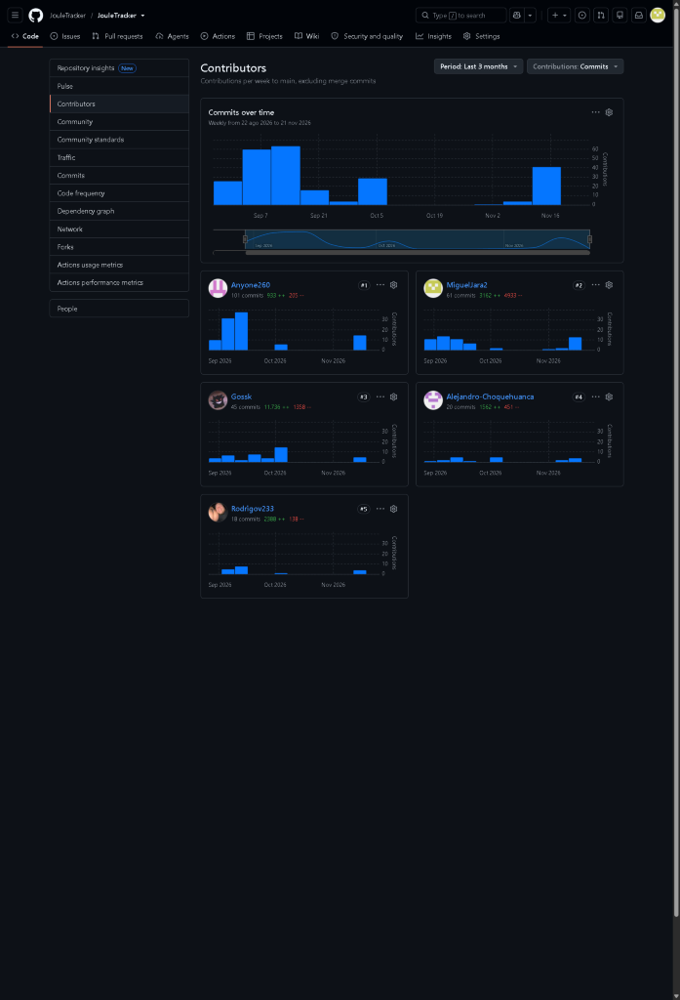

**Figura:** Detalle de contribuciones por integrante en el repositorio del informe (`JouleTracker`) durante el Sprint 3.

## 5.3. Validation Interviews (Etapa de Validación del Producto)

Para comprobar que la solución responde adecuadamente a las necesidades reales de los usuarios, realizamos sesiones de validación con representantes de nuestros segmentos objetivo. El propósito fue observar cómo interactúan con la Landing Page y la Web Application desplegadas, recoger sus impresiones sobre la propuesta de valor y detectar oportunidades de mejora.

### 5.3.1. Diseño de Entrevistas

A diferencia de las entrevistas iniciales de descubrimiento (*needfinding*), estas sesiones se centraron en evaluar el comportamiento de los usuarios frente al producto funcional. Queríamos verificar si comprendían de inmediato qué hace JouleTracker, si lograban navegar por las vistas principales sin asistencia y si completaban los flujos clave sin fricciones.

**Objetivos de la validación**
* Comprobar si los usuarios captan rápidamente la propuesta de valor al revisar la Landing Page.
* Evaluar si logran navegar por la aplicación y completar las tareas principales sin confusiones.
* Detectar problemas de usabilidad, organización de la información o diseño inclusivo.
* Recoger sugerencias concretas de mejora para futuras iteraciones del producto.

**Segmentos validados**
* **Segmento 1:** Usuarios residenciales (hogares).
* **Segmento 2:** Dueños y administradores de pequeños negocios.

**Escenarios y tareas de validación**

Para el Segmento 1:
* Identificar en la Landing Page cuál es la propuesta de valor principal de JouleTracker.
* Navegar desde la Landing Page hacia la aplicación web.
* Iniciar sesión y reconocer los indicadores principales del Dashboard.
* Completar el registro o vinculación de un sensor IoT residencial.
* Consultar el histórico de consumo energético y la proyección del recibo.

Para el Segmento 2:
* Identificar en la Landing Page cómo la plataforma aporta valor a la gestión de su negocio.
* Navegar desde la Landing Page hacia la aplicación.
* Iniciar sesión en la vista correspondiente a su rol comercial.
* Ubicar y utilizar el módulo de monitoreo de equipos de alto consumo (neveras, cámaras de frío, compresores).
* Interpretar las alertas de consumo anómalo y la analítica de áreas del negocio.

**Preguntas posteriores a la demostración**
* Después de ver y probar la aplicación, ¿te parece útil para tu hogar o negocio?
* ¿Qué parte o funcionalidad de la plataforma te gustó más?
* ¿Hubo algún botón, etiqueta o flujo que no entendiste o que te confundió?
* ¿Usarías una aplicación como esta en la vida real? ¿Por qué?
* ¿Qué cambiarías o mejorarías para facilitar su uso diario?

### 5.3.2. Registro de Entrevistas

**Video consolidado de validación**
* **Enlace en Microsoft Stream / Drive:** https://docs.google.com/videos/d/1pbwGMrpZxYrKGhcpf_nmrQ2SVKcwi-aBl0wV3Ilaba0/play?usp=sharing
* **Captura de evidencia:**  

  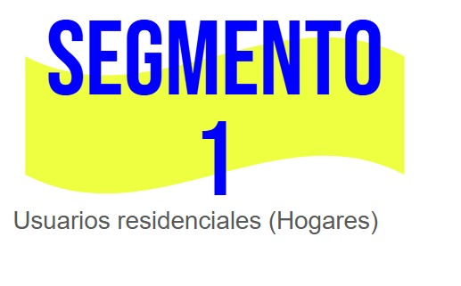


#### Segmento Objetivo: Usuarios residenciales (hogares)

**Entrevista de validación #1 – Jesús**


**Resumen de la sesión:**  
Jesús, jefe de hogar de 34 años en Los Olivos, comprendió rápidamente la propuesta de valor presentada en la Landing Page y navegó con facilidad hacia la interfaz web desde su dispositivo móvil. Logró completar la visualización del panel en tiempo real y la simulación de proyección de recibos sin asistencia. Tras responder el cuestionario, indicó que la plataforma le resulta muy útil para evitar sorpresas en los gastos fijos de casa, destacando especialmente la proyección del recibo mensual porque le permite anticiparse al pago y ajustar el uso de sus aparatos. Como oportunidad de mejora, sugirió incorporar notificaciones directas vía WhatsApp para alertas de consumo elevado.

| Detalle | Información |
|---|---|
| Entrevistador | Alejandro Samir Choquehuanca Vasquez |
| Entrevistado | Jesús |
| Segmento objetivo | Segmento 1: Hogares |
| Edad | 34 años |
| Ubicación | Los Olivos, Lima |
| Duración / Empieza en | 0:03 / 3:54 |
| Enlace | https://drive.google.com/file/d/1UIbZvTG5G1OCI_xwm2kHLPMxJkqk3cSq/view?usp=sharing |


**Entrevista de validación #2 – Fabrizio**

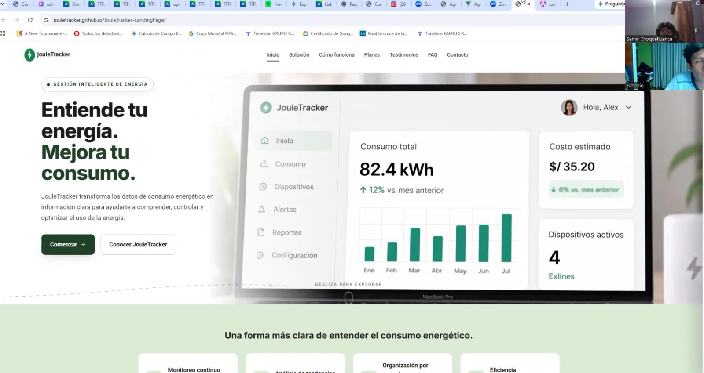

**Resumen de la sesión:**  
Fabrizio, joven profesional de 26 años que vive solo en Surco y trabaja en modalidad híbrida, revisó la plataforma mostrando gran interés en la integración con los sensores IoT. Navegó por el registro de sensores y el historial sin problemas, destacando que los gráficos por horarios le permiten identificar picos de consumo para optimizar el uso de su laptop gaming y electrodomésticos. Afirmó que usaría la aplicación en la vida real para reducir su consumo mediante métricas claras, y sugirió añadir gráficos comparativos semanales más detallados para contrastar su gasto entre semanas.

| Detalle | Información |
|---|---|
| Entrevistador | Alejandro Samir Choquehuanca Vasquez |
| Entrevistado | Fabrizio |
| Segmento objetivo | Segmento 1: Hogares |
| Edad | 26 años |
| Ubicación | Surco, Lima |
| Duración / Empieza en | 3:54 / 6:39 |
| Enlace |https://drive.google.com/file/d/15w2a33-enzOGESqNkPjR5XdLkVoFEl-e/view?usp=sharing |


**Entrevista de validación #3 – Fabrizzio**

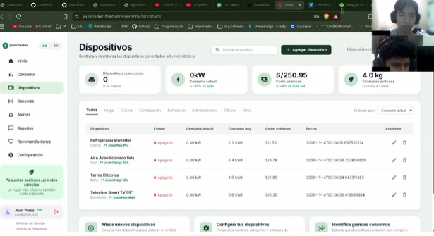


**Resumen de la sesión:**  
Fabrizzio, empleado administrativo de 45 años en Comas, evaluó el sistema enfocado en la seguridad eléctrica y el control de cargas elevadas como su therma eléctrica. Validó el panel general señalando que solo le tomó unos segundos ubicar el detalle por carga y resaltó que las alertas tempranas ante anomalías son fundamentales para prevenir recalentamientos y cortocircuitos en el hogar. Confirmó que usaría la herramienta por prevención y ahorro, y recomendó incorporar una interfaz simplificada con tipografía y botones más grandes para facilitar su uso a adultos mayores.

| Detalle | Información |
|---|---|
| Entrevistador | Miguel Jara |
| Entrevistado | Fabrizzio |
| Segmento objetivo | Segmento 1: Hogares |
| Edad | 45 años |
| Ubicación | Comas, Lima |
| Duración / Empieza en | 2:31 minutos / 31:49 |
| Enlace | https://drive.google.com/file/d/1VFXMz7oXkUPTre2H2ghGoUG3YA6TZKqj/view?usp=sharing |


#### Segmento Objetivo: Dueños y administradores de pequeños negocios

**Entrevista de validación #4 – Diana**


**Resumen de la sesión:**  
Diana, propietaria de una bodega en San Juan de Lurigancho con más de 10 años de trayectoria, probó el módulo de gestión de negocios enfocado en el monitoreo de sus refrigeradores y congeladores operativos todo el día. Navegó sin dificultades por la vista comercial y valoró muy positivamente las alertas de consumo anómalo, señalando que le permitirían actuar a tiempo ante fallos nocturnos para evitar pérdidas económicas de mercadería congelada. Como mejora, propuso permitir la personalización de cada equipo con nombres, íconos o fotos para identificarlos rápidamente.

| Detalle | Información |
|---|---|
| Entrevistador | Alejandro Samir Choquehuanca Vasquez |
| Entrevistado | Diana |
| Segmento objetivo | Segmento 2: Pequeños negocios |
| Edad | 40 años |
| Ubicación | San Juan de Lurigancho, Lima |
| Duración / Empieza en | 4:08 minutos / 09:14 minutos |
| Enlace |https://drive.google.com/file/d/1dcBQja8ckHnel0h7aB1eJVXhNXJcxIeZ/view?usp=sharing |


**Entrevista de validación #5 – Eduardo**

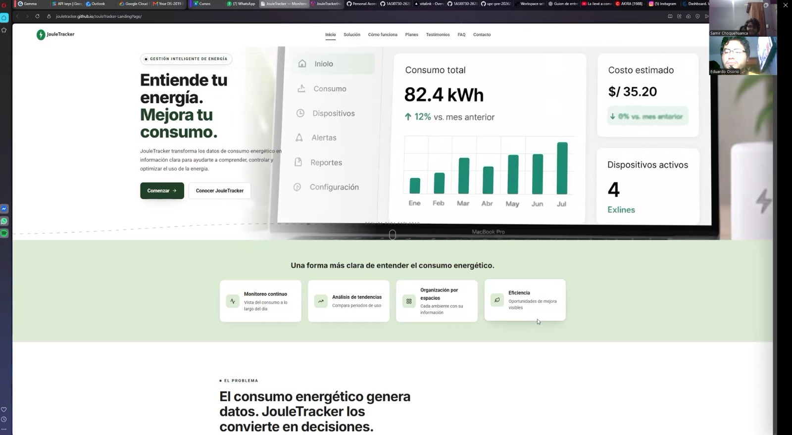

**Resumen de la sesión:**  
Eduardo, propietario de un taller mecánico de 38 años en Comas, evaluó la plataforma centrándose en el control de maquinaria pesada como compresores y máquinas de soldar. Comprendió el funcionamiento de los sensores IoT, navegó por el panel del negocio sin inconvenientes y destacó que la detección temprana de fallas eléctricas mediante alertas preventivas es clave para evitar reparaciones costosas y paralizaciones del taller. Como oportunidad de mejora, recomendó añadir un indicador visual de advertencia más llamativo ante riesgos de sobrecarga en el interruptor térmico.

| Detalle | Información |
|---|---|
| Entrevistador | Alejandro Samir Choquehuanca  |
| Entrevistado | Eduardo |
| Segmento objetivo | Segmento 2: Pequeños negocios |
| Edad | 38 años |
| Ubicación | Comas, Lima |
| Duración / Empieza en | 2:22 minutos / 13:24 |
| Enlace | https://drive.google.com/file/d/1Rw8pF8xe-pzzYa1N6XQ6kHlC9AqkMP5g/view?usp=sharing |


**Entrevista de validación #6 – Ricardo**


**Resumen de la sesión:**  
Ricardo, administrador de un minimarket de 23 años ubicado en San Luis, con 3 años de funcionamiento, evaluó la webapp enfocándose en las funcionalidades del módulo de monitoreo comercial. Durante la sesión, exploró el panel de gestión del negocio y comprendió sin dificultades la información presentada sobre el consumo energético de los equipos. Destacó positivamente la posibilidad de supervisar el funcionamiento de cámaras de frío y congeladores, así como recibir alertas ante posibles anomalías eléctricas, considerando que estas funcionalidades permitirían detectar fallas a tiempo y evitar pérdidas económicas por el deterioro de mercadería. Asimismo, valoró que la plataforma facilite el control de equipos que permanecen encendidos durante las 24 horas. Como oportunidad de mejora, sugirió incorporar una función de acceso multiusuario que permita compartir el monitoreo y las notificaciones con sus socios, facilitando una gestión conjunta del negocio.

| Detalle | Información |
|---|---|
| Entrevistador | Miguel Angel Vidal Castro |
| Entrevistado | Ricardo |
| Segmento objetivo | Segmento 2: Pequeños negocios |
| Edad | 23 años |
| Ubicación | San Luis, Lima |
| Tipo de negocio | Minimarket |
| Antigüedad del negocio | 3 años |
| Equipos de mayor consumo | Cámaras de frío y congeladores de helados |
| Duración / Empieza en | 9:06 minutos / 15:46 |
| Enlace | https://upcedupe-my.sharepoint.com/:v:/g/personal/u202314186_upc_edu_pe/IQA-cUzBQUt4SKMBxUgt3o2dAarf3bp-IHQFUZXLoC9acp4?e=GQjWDL&nav=eyJyZWZlcnJhbEluZm8iOnsicmVmZXJyYWxBcHAiOiJTdHJlYW1XZWJBcHAiLCJyZWZlcnJhbFZpZXciOiJTaGFyZURpYWxvZy1MaW5rIiwicmVmZXJyYWxBcHBQbGF0Zm9ybSI6IldlYiIsInJlZmVycmFsTW9kZSI6InZpZXcifX0%3D |


## 5.3.3. Evaluaciones según heurísticas

**UX Heuristics & Principles Evaluation**

*Usability – Inclusive Design – Information Architecture*

En esta sección presentamos el análisis heurístico de JouleTracker, tomando como referencia las observaciones obtenidas durante las entrevistas de validación con nuestros dos segmentos objetivo: usuarios residenciales y administradores de pequeños negocios.

El propósito de esta evaluación es identificar posibles dificultades relacionadas con la usabilidad, accesibilidad y organización de la información, para establecer oportunidades de mejora que puedan ser consideradas en las próximas iteraciones del producto.

#### Site or App to Evaluate

JouleTracker – Plataforma web orientada al monitoreo, análisis y gestión del consumo energético en hogares y pequeños negocios.

**Productos considerados:**

- Landing Page de JouleTracker.
- Web Application de JouleTracker.

#### Tasks to Evaluate

**Segmento 1: Usuarios residenciales (hogares)**

1. Identificar la propuesta de valor de JouleTracker desde la Landing Page.
2. Acceder a la aplicación e iniciar sesión.
3. Visualizar los indicadores del consumo energético en el Dashboard.
4. Registrar o vincular sensores IoT.
5. Consultar el historial de consumo y las proyecciones del recibo eléctrico.
6. Revisar las alertas relacionadas con consumos elevados.

**Segmento 2: Dueños y administradores de pequeños negocios**

1. Acceder al módulo de monitoreo comercial.
2. Visualizar los equipos eléctricos registrados.
3. Consultar los indicadores de consumo de cada equipo.
4. Identificar las alertas por consumo anómalo.
5. Interpretar la información del consumo energético del negocio.

Las tareas deberán contrastarse con las funcionalidades efectivamente disponibles en la versión evaluada. Las integraciones externas, los sensores físicos y las funcionalidades todavía no implementadas se consideran fuera del alcance de las pruebas directas de interfaz.

#### Escala de severidad

| Nivel | Descripción |
|---|---|
| 1 | Problema superficial que no impide completar las tareas y tiene un impacto reducido en la experiencia del usuario. |
| 2 | Problema menor que puede generar dificultades o requerir pasos adicionales. Se recomienda corregirlo en próximas iteraciones. |
| 3 | Problema importante que dificulta la ejecución de tareas relevantes. Requiere una atención prioritaria. |
| 4 | Problema crítico que impide completar una tarea esencial. Debe corregirse antes del lanzamiento. |

#### Tabla resumen de oportunidades de mejora

Las siguientes observaciones se obtuvieron de las entrevistas documentadas. La relación con los principios heurísticos y las severidades propuestas deberá confirmarse mediante una inspección de la interfaz.

| # | Oportunidad de mejora | Segmento | Severidad propuesta | Principio relacionado |
|---|---|---|---|---|
| 1 | Incorporar alertas mediante WhatsApp | Hogares | 2 | Flexibilidad y eficiencia de uso |
| 2 | Incorporar comparaciones semanales más detalladas | Hogares | 1 | Arquitectura de información: utilidad |
| 3 | Mejorar la legibilidad y el tamaño de los elementos | Hogares | 2 | Diseño inclusivo y accesibilidad |
| 4 | Facilitar la identificación visual de equipos | Negocios | 2 | Reconocimiento antes que recuerdo |
| 5 | Reforzar la visibilidad de advertencias de sobrecarga | Negocios | 3 | Visibilidad del estado del sistema |
| 6 | Permitir la recepción compartida de alertas | Negocios | 2 | Flexibilidad y eficiencia de uso |

#### Descripción de las oportunidades de mejora

**Problema potencial #1: Limitaciones en los canales de notificación**

**Severidad propuesta:** 2

**Principio relacionado:** Usability – Flexibilidad y eficiencia de uso.

**Observación:** Durante la entrevista, Jesús destacó la importancia de recibir alertas cuando el consumo energético supera los valores esperados. Como sugerencia, mencionó la posibilidad de incorporar notificaciones mediante WhatsApp para recibir información sin necesidad de ingresar constantemente a la aplicación.

**Recomendación:** Evaluar la incorporación de canales de notificación adicionales que permitan al usuario seleccionar cómo desea recibir las alertas de consumo.

**Evidencia pendiente:** Captura del módulo de alertas y verificación de los canales actualmente disponibles.

---

**Problema potencial #2: Necesidad de comparaciones de consumo entre periodos**

**Severidad propuesta:** 1

**Principio relacionado:** Information Architecture – Utilidad de la información.

**Observación:** Fabrizio destacó la utilidad de los gráficos de consumo energético y sugirió incorporar comparaciones semanales más detalladas para identificar diferencias en el gasto eléctrico durante distintos periodos.

**Recomendación:** Evaluar la incorporación de gráficos comparativos que permitan visualizar el consumo de la semana actual frente a periodos anteriores.

**Evidencia pendiente:** Captura del historial de consumo y de las opciones de comparación disponibles.

---

**Problema potencial #3: Accesibilidad visual para diferentes perfiles de usuario**

**Severidad propuesta:** 2

**Principio relacionado:** Inclusive Design – Accesibilidad y legibilidad.

**Observación:** Carlos logró identificar las funcionalidades principales del sistema, pero recomendó una interfaz simplificada con tipografías y botones más grandes para facilitar el uso de la plataforma a personas adultas mayores.

**Recomendación:** Evaluar la implementación de tamaños de fuente ajustables, botones de mayor dimensión y una presentación simplificada de las funcionalidades más utilizadas.

**Evidencia pendiente:** Capturas del Dashboard y revisión de los tamaños de los elementos interactivos.

---

**Problema potencial #4: Identificación visual de equipos eléctricos**

**Severidad propuesta:** 2

**Principio relacionado:** Usability – Reconocimiento antes que recuerdo.

**Observación:** Diana consideró importante reconocer rápidamente los equipos eléctricos asociados a su negocio. Por ello, sugirió personalizar los dispositivos mediante nombres, iconos o fotografías que permitan diferenciarlos con mayor facilidad.

**Recomendación:** Evaluar opciones de personalización visual de los equipos registrados para facilitar su reconocimiento dentro del panel de monitoreo.

**Evidencia pendiente:** Captura del listado de dispositivos y de las opciones de edición existentes.

---

**Problema potencial #5: Visibilidad de advertencias por sobrecarga eléctrica**

**Severidad propuesta:** 3

**Principio relacionado:** Usability – Visibilidad del estado del sistema.

**Observación:** Eduardo valoró las alertas preventivas de JouleTracker y recomendó reforzar visualmente las advertencias relacionadas con posibles sobrecargas eléctricas, especialmente en equipos de alto consumo utilizados en talleres.

**Recomendación:** Evaluar el uso de indicadores visuales diferenciados según el nivel de riesgo, acompañados de mensajes claros que permitan reconocer rápidamente una situación que requiere atención.

**Evidencia pendiente:** Captura de la pantalla de alertas y revisión de cómo se comunica actualmente una sobrecarga.

---

**Problema potencial #6: Necesidad de acceso compartido a las alertas del negocio**

**Severidad propuesta:** 2

**Principio relacionado:** Usability – Flexibilidad y eficiencia de uso.

**Observación:** Ricardo, administrador de un minimarket, sugirió habilitar el acceso multiusuario para que sus socios también puedan recibir alertas relacionadas con el funcionamiento de los equipos eléctricos.

**Recomendación:** Evaluar un mecanismo de acceso compartido o de destinatarios adicionales de notificaciones, considerando permisos y responsabilidades de cada usuario.

**Evidencia pendiente:** Revisión de las funcionalidades de gestión de usuarios y configuración de notificaciones.

#### Consideraciones finales

A partir de las entrevistas realizadas, identificamos oportunidades de mejora relacionadas principalmente con las notificaciones, la presentación de información energética, la accesibilidad y la gestión de equipos eléctricos.

Estas observaciones permiten orientar futuras inspecciones heurísticas y establecer posibles prioridades de desarrollo. Para confirmar la severidad de cada problema, será necesario contrastar los comentarios de los entrevistados con el comportamiento real de las interfaces y documentar las evidencias correspondientes.


## 5.4. About the Product

En esta sección presentamos **About the Product**, el video de presentación de JouleTracker elaborado por VoltLab. En este material mostramos la problemática que buscamos resolver y la propuesta de valor de nuestra plataforma para hogares y pequeños negocios: facilitar la comprensión del consumo energético, su monitoreo y la toma de decisiones para evitar gastos innecesarios.

El video permite dar a conocer el propósito de JouleTracker, los segmentos a los que nos dirigimos y las funcionalidades planteadas para el monitoreo energético, como la consulta de métricas, el historial de consumo y las alertas preventivas.

*Videos de About the Product:*

https://youtu.be/UYQWInpBB8s?si=wd2scFFZ2AHk5t90
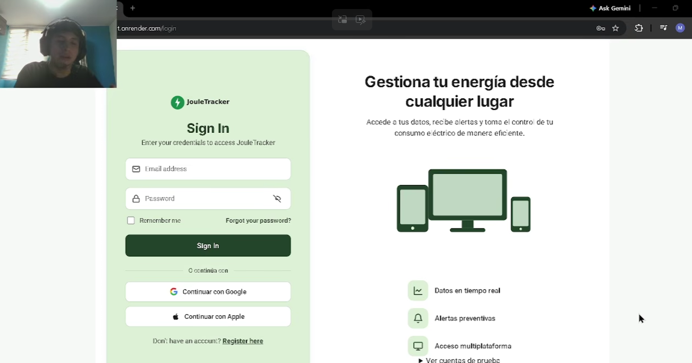

**Figura:** Presentación de la interfaz de inicio de sesión de JouleTracker durante el video About the Product.

### About the Team – VoltLab

En esta sección presentamos a los integrantes de VoltLab, el equipo responsable del diseño y desarrollo de JouleTracker. Cada integrante aportó sus conocimientos y habilidades durante las diferentes etapas del proyecto, desde la identificación de las necesidades de los usuarios hasta la implementación y validación de nuestra solución.


**Figura:** Presentación de los integrantes del equipo VoltLab, responsables del desarrollo de JouleTracker.

- **Google Videos:** [Ver video de JouleTracker](https://docs.google.com/videos/d/1bumlQ-HWnqWWbWQpgBiuDvokOq7Y1ieCQH4nA5uWWbA/edit?scene=id.hbcfc58d0c3316ee_2_1#scene=id.hbcfc58d0c3316ee_2_1)

- **YouTube:** [About the Product – JouleTracker](https://www.youtube.com/watch?v=UYQWInpBB8s)


## Conclusiones y Recomendaciones.

# Conclusiones

# AV1 – Sprint Review (Sprint 1)

El primer avance (AV1) del proyecto JouleTracker demuestra la consolidación exitosa de las bases estratégicas, arquitectónicas y metodológicas necesarias para la construcción de una plataforma SaaS IoT orientada a la eficiencia energética. A través de la aplicación del marco de trabajo Lean UX, se logró acotar el problema de negocio —la gestión reactiva de la facturación eléctrica— y se establecieron seis hipótesis de valor claramente alineadas con las necesidades de los dos segmentos objetivos: hogares urbanos y pequeñas empresas (MYPEs). Esta alineación garantiza que el desarrollo tecnológico esté justificado por un valor comercial y una necesidad real de los usuarios.

Desde la perspectiva arquitectónica y de diseño, el equipo VoltLab estructuró el sistema utilizando Domain-Driven Design (DDD), identificando seis Bounded Contexts que separan de manera cohesiva los subdominios principales (como Dashboard & Energy Analytics y Alerting & Optimization) de los dominios de soporte y genéricos. Esta abstracción fue plasmada eficazmente en los diagramas del modelo C4, trazando una hoja de ruta técnica clara que divide responsabilidades entre la Landing Page estática, la Single-Page Application (Angular) y la Backend API (Spring Boot/Java), lo cual previene el acoplamiento temprano del software.

A nivel de ejecución, el Sprint 1 culminó satisfactoriamente con la construcción y el despliegue de la Landing Page promocional. Al restringir el stack tecnológico a HTML5, CSS3 y JavaScript puro (Vanilla JS) y alojarlo en GitHub Pages, el equipo respetó el principio de separación de responsabilidades y las exigencias de la rúbrica para este hito. Además, la adopción formal de prácticas de gestión de configuración, como el uso del modelo de ramificación GitFlow y los Conventional Commits, evidencia madurez en el control de versiones y sienta un precedente de trabajo ordenado para la fase de programación concurrente que el equipo enfrentará en los próximos sprints.

# TB1 – Stage Review (Sprint 2)
Durante el Sprint 2 se desarrolló y desplegó la primera versión navegable de la Web Application en Angular, incorporando las principales vistas de autenticación, dashboard, sensores, alertas, reportes y áreas de negocio. La aplicación presentó una interfaz adaptable y soporte para español e inglés, aunque todavía utilizaba datos simulados. También se actualizaron los artefactos de diseño y planificación para mejorar su coherencia. Sin embargo, la gestión del código evidenció oportunidades de mejora, debido a la ausencia de pull requests e issues. La retrospectiva permitió identificar la importancia de definir anticipadamente los contratos de API y distribuir mejor las actividades de documentación y pruebas.

# AV2 – Sprint Review (Sprint 3)

El Sprint 3 representó un avance importante en la consolidación de JouleTracker como una plataforma SaaS IoT, al completar la integración de sus tres productos principales: Landing Page, Web Application y RESTful API.

Las seis entrevistas de validación, realizadas a participantes de los segmentos de hogares y pequeños negocios, demostraron una percepción positiva de la solución y respaldaron cualitativamente las funcionalidades principales. Se confirmó el valor del monitoreo energético, las proyecciones de consumo, la analítica histórica y las alertas preventivas. Asimismo, se identificaron oportunidades de mejora relacionadas con la accesibilidad visual, la personalización de equipos, las comparaciones semanales, la visibilidad de las alertas y el acceso multiusuario.

No obstante, las hipótesis todavía no cuentan con evidencia cuantitativa suficiente para confirmar sus criterios de éxito. En particular, la hipótesis de transmisión continua de sensores permanece sin validar por la ausencia de hardware físico, mientras que la conversión, retención y adopción de planes de pago requieren instrumentación y uso real de la plataforma. También permanecen pendientes algunos supuestos del modelo de negocio, como la disposición a pagar y la viabilidad de instalación de los sensores.

En conjunto, JouleTracker cuenta con una base funcional y técnica consolidada, pero necesita completar las funcionalidades planificadas, fortalecer su infraestructura y recopilar evidencia cuantitativa para demostrar su viabilidad como solución comercial.

# Recomendaciones

#### AV1 – Sprint Review (Sprint 1)

Para las siguientes iteraciones del proyecto, se recomienda priorizar la validación de la propuesta de valor mediante entrevistas formales utilizando la Landing Page ya desplegada. Recopilar métricas tempranas de interacción y retroalimentación directa de jefes de hogar y administradores de pequeños negocios permitirá al equipo ajustar el Product Backlog en Jira antes de invertir esfuerzo de desarrollo en los flujos más complejos de la aplicación web, mitigando el riesgo de construir funcionalidades que no resuelvan los dolores del usuario.

En el ámbito técnico, la transición hacia el Sprint 2 exigirá una coordinación rigurosa, ya que el equipo comenzará a codificar la Single-Page Application en Angular y los primeros controladores de la Backend API en Spring Boot. Se recomienda establecer contratos de API (mediante especificaciones como OpenAPI/Swagger) de manera anticipada. Esto permitirá que los desarrolladores del frontend puedan avanzar consumiendo datos simulados (mocks) mientras el equipo de backend finaliza la lógica de los servicios y la persistencia en la base de datos relacional, evitando cuellos de botella en la integración.

Finalmente, es fundamental mantener la rigurosidad en la documentación de la gestión de código fuente. A medida que el número de repositorios crezca (separando frontend y backend), el equipo debe velar por el cumplimiento estricto de GitFlow, evitando fusiones directas a la rama main sin la respectiva revisión de código (Pull Requests). Asimismo, se sugiere automatizar progresivamente el proceso de pruebas y despliegue (CI/CD) para los contenedores principales, lo que garantizará que JouleTracker mantenga un entorno de producción estable y demostrable en las futuras evaluaciones del curso.

#### TB1 – Stage Review (Sprint 2)

Se recomendó documentar los endpoints antes de iniciar la integración entre Frontend y Backend, así como validar la aplicación con usuarios de ambos segmentos. También se propuso fortalecer la gestión del repositorio mediante pull requests, revisiones de código e issues, además de mantener actualizados Jira y la documentación del proyecto durante cada Sprint.

#### AV2 – Sprint Review (Sprint 3)

Para el siguiente avance, se recomienda completar las funcionalidades pendientes de JouleTracker y mejorar la experiencia de usuario a partir de los hallazgos de validación. 
En el Backend, se recomienda implementar la recuperación de contraseña, los pagos mediante Stripe, la actualización de perfil y las alertas por correo mediante Brevo, además de evaluar WhatsApp como canal complementario. Asimismo, es necesario realizar un piloto con sensores físicos para validar la transmisión de datos y revisar la capacidad del entorno de producción para evitar inconvenientes durante las demostraciones. También se deben incorporar al Product Backlog las mejoras solicitadas por los usuarios, especialmente la accesibilidad visual, las comparaciones semanales, las alertas más visibles y el acceso multiusuario.

---

# Anexos

- Organismo Supervisor de la Inversión en Energía y Minería (Osinergmin). (2023). *Guía de orientación sobre el uso eficiente y seguro de la energía eléctrica.*  
  https://www.gob.pe/osinergmin

- Al-Khatib, W., Al-Ghamdi, A. S., & Khan, M. A. (2021). *IoT-based smart energy monitoring and management system for residential and small commercial buildings.* Sustainable Energy Technologies and Assessments, 47, Article 101416.  
  https://doi.org/10.1016/j.seta.2021.101416

- International Energy Agency (IEA). (2023). *Energy Efficiency 2023: Analysis and key findings.*  
  https://www.iea.org/reports/energy-efficiency-2023

- Instituto Nacional de Estadística e Informática (INEI). (2024). *Comportamiento de la economía peruana e índices de actividad comercial y de servicios.*  
  https://www.inei.gob.pe/prensa/noticias/

- The Markdown Guide. *The Markdown Guide.*  
  https://www.markdownguide.org/

- Tamim, N. *How to use PlantUML with Markdown.* GitHub Gist.  
  https://gist.github.com/noamtamim/f11982b28602bd7e604c233fbe9d910f

- Structurizr. *Embedding diagrams.*  
  https://docs.structurizr.com/cloud/embed

- Progressa Lean. *5W+2H - Técnica de análisis de problemas.*  
  https://www.progressalean.com/5w2h-tecnica-de-analisis-de-problemas/

- Fowler, M. *Ubiquitous Language.* Martin Fowler.  
  https://martinfowler.com/bliki/UbiquitousLanguage.html

- Open Practice Library. *Ubiquitous Language: Unambiguously define the terms and concepts of a business domain.*  
  https://openpracticelibrary.com/practice/ubiquitous-language/

- Lean UX Canvas Chapter 3. *Scribd.*  
  https://www.scribd.com/document/655516553/Leanux-Sampler

- Mountain Goat Software. *User Stories Articles.*  
  https://www.mountaingoatsoftware.com/blog/tag/user-stories

- UXPressia. *User vs. Buyer Persona: Differences and free template.*  
  https://uxpressia.com/blog/user-persona-vs-buyer-persona-difference

- UXPressia. *How to create an Impact Map in 4 easy steps?*  
  https://uxpressia.com/blog/build-impact-map-4-easy-steps

- IBM Design Thinking. *As-is Scenario Map: Build a better understanding of your users' current experience.*  
  https://www.ibm.com/design/thinking/page/toolkit/activity/as-is-scenario-map

- IBM Design Thinking. *To-be Scenario Map: Draft a vision of your user's future experience to show how your ideas address their current needs.*  
  https://www.ibm.com/design/thinking/page/toolkit/activity/to-be-scenario-map

- IBM Design Thinking. *Empathy Map: Build empathy for your users through a conversation informed by your team's observations.*  
  https://www.ibm.com/design/thinking/page/toolkit/activity/empathy-map

- Nielsen Norman Group. *Empathy Mapping: The First Step in Design Thinking.*  
  https://www.nngroup.com/articles/empathy-mapping/

- DZone. *Acceptance Criteria in Scrum: Explanation, Examples, and Template.*  
  https://dzone.com/articles/acceptance-criteria-in-software-explanation-exampl

- Dittrich, J. *A Beginner's Guide to Finding User Needs.*  
  https://jdittrich.github.io/userNeedResearchBook/

- Modern Requirements. *Using a Requirements Traceability Matrix to Improve Project Quality.*  
  https://www.modernrequirements.com/blogs/using-a-requirements-traceability-matrix-to-improve-project-quality/

- Otiscole. *Customer Portfolio – What's Cookin'.*  
  http://otiscole.com

- UX for the Masses. *A step-by-step guide to scenario mapping.*  
  http://www.uxforthemasses.com/scenario-mapping/

- CareerFoundry. *What are User Flows in User Experience (UX) Design?*  
  https://careerfoundry.com/en/blog/ux-design/what-are-user-flows/

- UX Design. *User flow is the new wireframe.*  
  https://uxdesign.cc/when-to-use-user-flows-guide-8b26ca9aa36a

- Nielsen Norman Group. *Design Systems 101.*  
  https://www.nngroup.com/articles/design-systems-101/

- Nielsen Norman Group. *Front-End Style-Guides: Definition, Requirements, Component Checklist.*  
  https://www.nngroup.com/articles/front-end-style-guides/

- Nielsen Norman Group. *The Four Dimensions of Tone of Voice.*  
  https://www.nngroup.com/articles/tone-of-voice-dimensions/

- Driessen, V. *A successful Git branching model.*  
  https://nvie.com/posts/a-successful-git-branching-model/

- Semantic Versioning. *Semantic Versioning 2.0.0.*  
  https://semver.org/

- Conventional Commits. *Conventional Commits.*  
  https://www.conventionalcommits.org/

- W3Schools. *HTML Style Guide and Coding Conventions.*  
  https://www.w3schools.com/html/html5_syntax.asp

- Google. *Google HTML/CSS Style Guide.*  
  https://google.github.io/styleguide/htmlcssguide.html

- SpecFlow. *Gherkin Conventions for Readable Specifications.*  
  https://specflow.org/gherkin/gherkin-conventions-for-readable-specifications/

- Tune, N. *Domain-Driven Architecture Diagrams.* Medium.  
  https://medium.com/nick-tune-tech-strategy-blog/domain-driven-architecture-diagrams-139a75acb578

- Domain Storytelling. *Domain Storytelling and Requirements.*  
  https://domainstorytelling.org/#dst-requirements

- Open Practice Library. *Domain Driven Design: Tackling Complexity in the Heart of Software.*  
  https://openpracticelibrary.com/perspective/domain-driven-design/

- Angular. *Angular coding style guide.*  
  https://angular.io/guide/styleguide

- Google. *Google Java Style Guide.*  
  https://google.github.io/styleguide/javaguide.html

- Google. *Google TypeScript Style Guide.*  
  https://google.github.io/styleguide/tsguide.html

- Spring. *Spring Boot Features.*  
  https://docs.spring.io/spring-boot/docs/current/reference/html/features.html

- HubSpot. *Full List of Meta Tags, Why They Matter for SEO & How to Write Them.*  
  https://blog.hubspot.com/marketing/meta-tags

- Sameera17. *How to Write a User Story for an API Product.* Medium.  
  https://sameera17w.medium.com/how-to-write-a-user-story-for-an-api-product-7af6abd4ad2e

- Connect2Grp. *Using PlantUML for Creating Clear and Concise Diagrams.* Medium.  
  https://connect2grp.medium.com/using-plantuml-for-creating-clear-and-concise-diagrams-2fc621529560

- DDD by Examples. *Big Picture EventStorming.* GitHub.  
  https://github.com/ddd-by-examples/library/blob/master/docs/big-picture.md

- DDD by Examples. *Design Level EventStorming.* GitHub.  
  https://github.com/ddd-by-examples/library/blob/master/docs/design-level.md

- GitLab. *What is GitFlow?*  
  https://about.gitlab.com/blog/what-is-gitflow/

- Atlassian. *Gitflow workflow.*  
  https://www.atlassian.com/git/tutorials/comparing-workflows/gitflow-workflow

- Kummer, D. *git-flow cheatsheet.*  
  https://danielkummer.github.io/git-flow-cheatsheet/index.html

## Anexo A. Videos de Exposiciones

Videos de exposición del proyecto publicados en Microsoft Stream. La relación se amplía con cada entrega.

| Entrega | Título | URL |
| --- | --- | --- |
| AV1 | Exposición AV1 – Sprint Review (Semana 4) | https://upcedupe-my.sharepoint.com/:v:/g/personal/u202512856_upc_edu_pe/IQCcVnA86T4QTr-Q8NM1xCGmAQ0SN2movemV7qMLGIxLcds?e=YFStMk&nav=eyJyZWZlcnJhbEluZm8iOnsicmVmZXJyYWxBcHAiOiJTdHJlYW1XZWJBcHAiLCJyZWZlcnJhbFZpZXciOiJTaGFyZURpYWxvZy1MaW5rIiwicmVmZXJyYWxBcHBQbGF0Zm9ybSI6IldlYiIsInJlZmVycmFsTW9kZSI6InZpZXcifX0%3D |
| AV2 | Exposición AV2 – Sprint Review (Semana 12) | **[PENDIENTE: pegar el enlace de Microsoft Stream]** |

<div style="page-break-before: always;"></div>

## Anexo B. Repositorios y productos desplegados

**Repositorios en la organización de GitHub**

| Repositorio | Contenido | URL |
| --- | --- | --- |
| Organización JouleTracker | Organización pública de GitHub del equipo VoltLab | https://github.com/JouleTracker |
| JouleTracker | Informe del proyecto (Project Report) | https://github.com/JouleTracker/JouleTracker |
| JouleTracker-LandingPage | Landing Page (HTML5, CSS3 y JavaScript) | https://github.com/JouleTracker/JouleTracker-LandingPage |
| Frontend | Web Application (Angular) | https://github.com/JouleTracker/Frontend |
| Backend | RESTful API (Java y Spring Boot) | https://github.com/JouleTracker/Backend |

**Productos desplegados**

| Producto | Entrega | Plataforma | URL |
| --- | --- | --- | --- |
| Landing Page | AV1, actualizada en TB1 y AV2 | GitHub Pages | https://jouletracker.github.io/JouleTracker-LandingPage/ |
| Web Application integrada con el RESTful API | AV2 (Sprint 3) | Render | https://jouletracker-front.onrender.com/ |
| RESTful API: documentación OpenAPI en Swagger UI | AV2 (Sprint 3) | Render | https://jouletracker-api-kmok.onrender.com/swagger-ui/index.html |
| RESTful API: URL base de los endpoints | AV2 (Sprint 3) | Render | `https://jouletracker-api-kmok.onrender.com` |
| Web Application con datos simulados | TB1 (Sprint 2) | Render | https://jouletracker-app.onrender.com/ |
| Servidor de datos simulados (json-server): URL base | TB1 (Sprint 2) | Render | `https://jouletracker-api.onrender.com` |

<div style="page-break-before: always;"></div>

## Anexo C. Herramientas de gestión, UX y diseño

| Herramienta | Uso en el proyecto | URL |
| --- | --- | --- |
| Jira Software Cloud | Product Backlog y Sprint Backlogs | https://alejandrochoquehuanca007.atlassian.net/jira/software/projects/JOUL/boards/1/backlog?atlOrigin=eyJpIjoiYzkxZjFiZTFlZTEzNDEwMzk2ZmEwZDBhODJmNDI4OWYiLCJwIjoiaiJ9 |
| UXPressia | Artefactos de experiencia de usuario (User Personas y mapas de experiencia) | https://uxpressia.com/w/NxJgO |
| Miro | Tablero colaborativo del proyecto (ideación y trabajo visual) | https://miro.com/app/board/uXjVHqBr2y8=/ |
| Miro | Design-Level EventStorming | https://miro.com/welcomeonboard/TnpJZmYyak5sRFNiYk9yemozbUJtUjBLZDZyYUpTek9McmxaMk9lM0VlTkFEZy81cU5OWWxrZ0U2Rkp0aUxVbWxMOXhrbDEvNkU5QTE3djZjbDNXb0tKa0EydzdPN20yN3dxUXNXSzdXb1J4ZDJITG5ndnJXN1piUnEyeEJpdEl3VHhHVHd5UWtSM1BidUtUYmxycDRnPT0hdjE=?share_link_id=815831854787 |
| Figma | User Journey Maps de ambos segmentos | https://www.figma.com/design/edK8BubeLxHBk7XgWAAwqs/Journey-Map-Template--Community-?node-id=0-1&p=f&t=hFmkmXytS2RPTiam-0 |
| Figma | Wireframes y mock-ups de la Web Application | https://www.figma.com/design/I9Hbim3oES3bOynqQrzlHw/JouleTracker_Mockap-II--Desktop-?t=t6nxRhPCoFxgRXay-0 |
| Figma | Prototipo navegable de la Web Application (desktop) | https://www.figma.com/proto/I9Hbim3oES3bOynqQrzlHw/JouleTracker_Mockap-II--Desktop-?node-id=24-13&t=ywhOr6HZ8TOlJlUd-1&scaling=scale-down&content-scaling=fixed&page-id=0%3A1&starting-point-node-id=24%3A13 |
| Figma | Prototipo navegable de la Web Application (mobile) | https://www.figma.com/proto/2cOm4G2UT14h4DdrItKjsA/JouleTracker_Mockap_mobile?node-id=2-66&t=e5ma48eTjakvBbnU-1&scaling=scale-down&content-scaling=fixed&page-id=0%3A1 |
| 1001 Fonts | Tipografía Inter (títulos y encabezados) | https://www.1001fonts.com/inter-font.html |
| 1001 Fonts | Tipografía Roboto (textos generales) | https://www.1001fonts.com/roboto-font.html |
| Coolors | Paleta de colores de la interfaz | https://coolors.co/214029-dcedd5-bed4c2-4f378a-eaddff-ffffff-1a1a1a-404040 · https://coolors.co/214029-dcedd5-bed4c2 · https://coolors.co/4f378a-eaddff · https://coolors.co/ffffff-1a1a1a-404040 |
| Visual Studio Code | Editor de código fuente | https://code.visualstudio.com |

<div style="page-break-before: always;"></div>

## Anexo D. Diagramas de clases UML en PlantUML

Diagramas de clases de la sección 4.7.1 que el equipo mantiene como código en PlantUML.

| Diagrama | Producto | URL |
| --- | --- | --- |
| Device Management Context | RESTful API (Backend) | https://www.plantuml.com/plantuml/png/tLXHR-Cs37xthn3wijmL3RBjBIYAowMvmK0lnPfqm1vLYtM5isLFadl8jlllOwmufMSnItO5XbrV78dyAFAZI4bzvxoqlYcBf817BtmbhCwVl53QGkPrPHBtIPjQMbcAMcQVP0uhlob0RCNIv0KGXQoGpisyj_gXyP1cbLdftq5CaYUjG41P-uqeeNm0wvB4PHBD_32PJCHdhVmJiQDgBNwSJ99ajw8uK_2iCoYbmL49nezbNHSwariFnuyoamhEn1-9428u8QvRmCSzu4Eh8oulmu-hgw3T_frZCBbs7cn0ZRAgnANKLAHtFS4ypB-PximJ2nZheyuR2mCJSoePskZ4RIZ4e5Hg1SPLTbqDJCxwCceqp1CxEVYWytwJgj5l3TWDMlY9plwydQH14MomvzvlWf2QY0WxIpT8scMGNhNslYHV3cLJLQNKPbnM2eenJcYlmNK91TEKEzzMNlh6aTJDvklqbyL-c2x_Dl5nbYxNY-LiEN-PkqvNyzlbSZ5VBwvtphsi4vm-UPqFi_kRzQ_K6js6kErcUMuXbnx4NLNvtlQx41gJUd-VNfCf8ql0R7ghJKwcrIxTYXUkDtLCwDgGfZqY8nKmmkmzLreHKLChwNU8aO7FguWbYg84xFX40XRRh6uE1Kw3I8zcnBKBC44tHli3ND1aqrgMXNwmqiE83IjIkwyHevDbNQ2lgV5WdsMnWgmo2ZtTJkHWYQgtqhXIEuTB7rOdIGmEax1EgynT1zfNfjwkYzqNc4Q9bEn-1KveOrdA4laboI6opeZYDRgjJZH8beXdJFyzvDg-rRtf4aIbgtYEK9dGJlJNVA88Xd6Uw_IdktyCxwkkbbYDUwCzaPswWRPdXuRX_eaTI1XY-pqom25tt05rWkKJ0eHd7BZO9QGh3L2BhGwkVjr2sb7V1wOpeA3AiiQYYLk3ZLTwMEiIk6wBcmPKjs6-OitGMazpvXYgBDILqxvYjaB7Mb1gqzKD1ZbpyXb6OPtkG1eUO8_QgFRsqxLYSjU9xfn0umaU1AQw0uNpOB-x-ep_-_kI0xiLkAunXp53AkaUgw3txL-1JwInlTh-8ubjxo0K_h-ksjeyMkcyRJBVMA2r66bUj0pJiYvUiVROxiMi-9_LsZx_3ibo7clDU5iL1TWeOVEz-51vMS3SEZyL_Ugw2zFePJTsTMKSn8hYnSQ-5bxWOKpXfuPfmLMDROV1QZ_QkECqvFY5_VpG4-QSUyBGRJ88zxZ3ZF66VpwWa3uVlfB3a0ckneAm5qXNBySo5zuqHC0K5xyKpzQh4OAEGFaGIeVdOTPfzRpqLISVDfq-dWl-IFk35iENqtVYRd4pcwUtoyKg2Kw8Yukh_YCxWDjv-k3izC--FnDlBoxmEnw_FTkf38IJLXWxBvDu9Ox7VrunXtT2AeWgSsTgaWnQ6mR3_OjjAXe7Ze4mUMOmX3CMap1k89IvzKo5WW9owS4T1jFJVWXDujR7OuvsH3_Xfm37G-bTwNGiII27JcXO51ovfn0OZsAk9XJCk4n89bVjaDP3aB0U2w4-7buZYLvni1OYc8IkIdKZ3iKDam901sgmJZlledR9lgUgVEgPboPYcuT2kwU3suPzD59umfKkZOfMCQj9P8Z8BBJLn5KvPGBD7wKPCP-y0wEQilWB |
| Energy Monitoring Context | RESTful API (Backend) | https://www.plantuml.com/plantuml/png/xLbHRzis47xNho3oigvP36zxCugWhkCM1fpOjTk-qz95vYgHAacvSBV-zr4KevvDiRGm3CE6zIMMxlYHz_6xEr9zgJILkYwBf817JRGWakLxJJ8c8TLCy4HzPBoYafQaekb7ciDM7miWZPdol03aa1PKgQdMakrg3OjKy2tx0cISx5a61CfA7qa9vGwaIXALKWFpotWy9fzPflS89wiO-NKyJX8t8xa23Z8_be8pBIJZ-OXMLS5Isgnmz4XJci4L-JqXXBIB87CxuBuRyDhwa1SlsX-tjywx-NVT12DaTWzKrH9AuFfPAigIycn25fjpswmr_JXnao0JWgoaI44fP7n5TRf7mEj-Zs_mvnQ4RfRKR43_YcUUiHVJkHa64N0EUaarg1FeJpN8em5-qsDyszWYNEI0HwXNnpiui1GGRg_z2Nh9b7xXuT_Q2RucNxydaqoKbF5HAJ8eHcOGqmpKarA0roMnp6urrRL2abYjvm_TmtgpcistsyN3c-xLR7M_NixVpU-wDw-dYwLxD2lguD_Mj63ww4tmORfSV1kyVRzTpsVlkkV5GsD7Q4xMdYICeATvBY6d6iX627qYx1l2Z1xUlqSptP3CShlm3ROIG3RL4t9duDwn4f0LU1QqbLXKDJTE2wuX1udHBGCJpBUVBMsAc2q_29PXkHT2WM_4rFW2DDpCkJRanpdPDT2B8Lm1LqBw1aT5c4Mxo9dWgYwh9lMC5wIif0LogiHda7s6WoWqpQ7FbDPI0jTzfaS99j5uUWpEPMgY5lwCNM4CauxeTaeth7-WHGrajViDqhWUiNXw-Fo4ysTocawO6VCwiztW7fIo76rrKm5GBCu774OJr4w80YZtukelas513GnAI9OpJWjBLEzkjdD25lDWWc-0Ai5xucrQvF7Rwfzn-7mAznEH9sFTBW-kgwxpT7MLSGtID6K8Dqz3fVk5k7IjuiubdTaWJ9opRbtczLldv_bbt11xoFD3cqj1-wnDA6H7Aa4X1jjuF53hXoBfn_UxUHmQUuUecc6DXNbevMNCJYI3rT4qUGOzuWWV9qnazcz86n7EWWUAuU38kdPgGQqDgP9zmSO19C41k7Ri15jPcqQGpGzjNxkpO-sJ2oDUUFn-DhGlYTHscMp5KM-B7b5SVWGN7s_3moVkj3sSiFZC0pPNGYMKUHT807-VdRzLwTE39rL53_0ChRldyEqVeHuPpruTZRYPYp9mPiV-RNO-POyPw_GJG_0JybmK0mArel0lGvT4w8yQi7SAP1EiwjgRUmxlOmVXolAs7O53-l-cEPn_UqiSmBwjxfZx_-ZTbl57IPMMTQhDCB_M-Et4BpEBiYh-TRKbt6lymFxXMjB9L8qaA6rg2TTI50N8tZr29QHpZ9GFUxbJPf-ywh5fBOX9P5ALu0e2oU63EzDmy87yI52YbisZc_gKfc2GcAJGAUSwT6k_lkJuSns-VL_xjszFgJw1yON_DVxSBaHhWVF32y4tMdzjVpztpXJuc3AS5QeKbBjWqlbaJDs0q-JJmjaZ5VB2hFY1RERBwMonUfXl4-_3titDxSctClzBYtKv-I3YerpzV4MUtzoGg_5ezFogfwHwRqw6c9_-lE4nRff0wq-2oJiQ_N4RFluaE7VySU7EdIJXgch92_mdmOJK2bHyS5Gy3YW9p6DGecV72ScWWBo9Rn2C9Q0F98dDE1fzPoyCrDxyAK1TWXCvUGv6yu-RFb0Ie0BXX1M3SE8muQCTHeepxZOmV4XpEheCvvpgE8oBRE1YaiYfqYNdTxoyQjKB47QABw4tJKq05KZ5bFRhPS_uSnSy_1BLnZxc6BXwLp2rlom98fzNXiDvfReFAOaNkm3PJYt3nljk1YULq1Qmby2pkYp-1000 |
| Monitoring Space Context | RESTful API (Backend) | https://www.plantuml.com/plantuml/png/vLXBR-Cs4BxpLn2-DDrk3BUz6K6mZkqs0l90hRZNWf4cDh4IfP9K2hVT_rwAuieZUyAiaLuMcqDipUFZl3do1sE5jarPi0AUBBSLrtApjJoN6Z8hAyNCHwbgeKN9Qv5z51j8xQu0thA5sXI01B9263EpLil7naAILIgLVmEViAtCWKDPsnqleNm4RHWpcN0mFqqc4_wNpEqMuUIrv3zF9eo54_ceh9IqbPPgOnmDngAk2vc9ri3nayX43YF-3-ESTpRmsru-RUL_yIByugBxSdaPXDk_7tYcGLW8Af1xZREiAakXyYbFvWHxtd6_d_8X7Q6Al2FTUeSHtcp0s2CX8e9fwbnOyBmKh6qZWB3Mnrm4YCW8SGFMSwvsINxsPmDwvu1-HSJVMXhjsX31NEtM1ZG14pXxh1jfxCKGyD8ZVcAV8ddEgr98DIwh78enA2kj1FCvrQ2QidFoOLS3Ikdr_JfTNj_VB7hArJfDxfPf-iVy_lPskPedivkUbzmjrkd3Af2SGGVWgHMsCGX-Ddz8VbyY_GF2R3M_TiyB38VBCWIWhSVPPgDX8opmLLNPGLsUS-aol5ud2qHIeWINMDj6297Dvo1Cz_50x1nCfcNTTWkbxFsROcUFcgFh2PV7vqhcHzMv02jaOSwmTU-fKp403WokVHULPPletUlHA0VXJ8u56WEQ86ie_EWmMrdxg0NpSFSQ8pSgz6xSxD1X_wVTMQCrg6n7P0iKwCrkxG0m4wS3pOa3cFU4Tl3jr5uC8wZlHQaiw2Sd5fsNBaRX6mfIc2XtedGLXfn2lBweNn9Ox6iDYuHyOVl8-HktB6J90OSyOMOOW2HlTL1dhvf6Z_CtsJSFDV1Iv9PzHM29qugXdVuIZck1k5QS7_xpTI_e2D4N38rAf-VB78DdK3PuH4_lhippPIlepbzuFVzqO8N1JOxeLURxCxzNKxvmK0-oXEXaT8NxblF8OKYRyULnqb1NnZF8_0z3jWh2Fc7xXqFxnJES-KCELv3Z--T9gjplCJ8uHgyjM3XK18x6c_SJX_KiCp3zM0pFH4JmE4mxiMzp6Jqji7x1V2siVWQWe7wLAwzKJreOgvlCDXg81aFZYEojfAoBhxQX-fGQvxcnhg6KrLLHW8uFurxC2T7BgmQNCMEdVBudhZeQzZ7GJLqfSz11eNbwe67lxB4m4GETvhdxLpMwU_J8mm0GRc3NwJU5S3dGEo-ri1_THxJJRxX_Oilu6q8MuXvlcI24hSVh-kcXZ5pUySDEZzw9eN7ME3E8DY8ZCWlImswoLU2_F4rekBszt_7LycOsJ-xTopWR2lFpyqlqzaemyGlg0NlquuY_Ep_deybu_6w4unwJT5y7rn8ZUcey_lSoUkqogYE27dszClRIyF9kqhzTJTiACAzhnf8PC1XzWaEWrvCfpw7mlrAOY2gwWYb5HaAFn_7WEeYj-oZ0HFI7GJv1CxAn87M6F4FQn0A1b6WTUbl0YcISV80ZotJ8Aphp93qMtIHS8KSmehf4KRepQz166XihYSYRbjDl7Wjfjh74qYzDM9N5UeNk9xe5QKrQXa_3HcBO1r1vKnR_0G00 |
| Recommendation Management Context | RESTful API (Backend) | https://www.plantuml.com/plantuml/png/tLXDR-Cs4BthLn2-DDr53BUz6K6mhkrc1UGZjUAsLqQQA4GaKIL7NhZj_lUEP4OX8rdq6jbBSh58pZoIR-ODoNpIo1LMUHPay80C9LCYVKIM20Kn2ba4-aaK9LSyPoMFdtWA4MupOFKmBz8CB8CuurhF49Muhn32M1QH-0VO97WK2J38Izoo7F9xK3e8TCm9vkV9PCA-Y0GVBPoa5EoNoIG8p8niHBF9F8SYuVMQSbvGBpLnpCio4t7JEtxWCKzWnFuD66ExnR2LutZLElxMsBApizt7-Rdngly-iXGAK1p1zJwf6xn8fYoyw3MOxyP_dBwQraAkogJZ5Y77Iblewxr61yoG0hfZ-jTjH4J2oTyLg6sz-7qMlzS6X7qfD9wv9kVM31IukCeuGiGteaXNeAiCTGi_xnr-nhOx6yolmTT30ft8d8jYdCi4iZ5r21IWdsCDHPMpMoMa4hYzX0raLZWlR_vilw-MYt1zrJO_XnUVsyPwTR6ylZDhUe7j2uE5FflVXNyihUPyUNktNBGTYp2w2gF8wbd-THkkgDrEr9-hb9kpD5MGSWIsaXAT73rbWZ9blGuNLbSk2u5IGT94C-mQeC0CA0QeA0PMVscecxeaMXQWKUGS8Td5RyeM45E7RQ8RQgQzXFLewuIIOID5qX67aKC1Nw81HEFjOt4M6owN1TAs_1ow2TZ38MyG5w1Z9ShwiuTFKGkrp021_E-bp83R4isvUfgzc9pitOijbhVSGns2T4lea5YHx0PxBZNsMtNBWAPjj5R72jlKm5ROea1GLDV1KtA97FFLgUHuvQg2w3PyE5PtjJHeo0sc6NnMnRxnfQkEBXFkPZmLthSXrstVXgwVzMCj-jYmrALTG3SglhE4Tj7y7XwKVhw6pfJk73wUZg01DjJGGrUBv_HCbhKfBMhHU3OjTsaUUPA1ZEDA4JSt1UKHOTw97Fo5BeRo-qr_16SAIgafo7ionrt-oXWtyMmRhuEg-GPEt7bVdmxTK-L150abfSapRH-DthkESIO_yUBYMX_1Z0Qr4J7ejjoPjfSbKnAYdVqxkB8UoLjprJoOjQOyj9oz_wkoA1uKrwYg62i5jWu7AfWjmJ0litUbkpOrDB6XaNHNe99P1cgGaNbhrYirOeG2gN7A-hMrsWrtLauHBMMXOT_DjuLTMxr-iEFfKA1bfUgccTfbPNXx3ZLEbAt-_eV7n_RXqHqQVd7O1s4VJTzsuBLFZNOPRqEc2SsmweoHisBn_HaqyNgpRTFE8BytYlBkTcQiNM6XDEFUOkDNmGzijRoSpSERwsKKkCRizFJSVUZs6VITPQ_jHZ-Ds8VJKpQQZCSVHhrFpo4N-dHgV30ijF7ultFFEHvqjM3y_2Tq4EojViI7xpzfKrPfq1u8JouOZC0p5K5vBaPJba06AKVGHu2P-q8NAXYUTJpsXOVG7kad0-s7yaVCXWk6za1etfTQ2-L76dgC6HW_MSJxm1l0PCB0KWu320QlE2IC0OnXtsu-qvmbA2qq7fGfWyz7WghkCw4V3ygKePUWZHJu1DZTbAjhlsVNXX1Y1JlzVAB1Ai_-1m00 |
| Frontend Web Application Class Diagram | Web Application (Angular) | https://www.plantuml.com/plantuml/png/jLZDRkCs4BxxAOZjeGxIw064G5Ylas2ttRQB9DiUYXveSQAmAv72a79gj7dtweUcDQPCEmroCi7vcMyu_3unUMyiHzjKvUnxzgDkIhX7ddy3PB_3YYtgkfGvjr8hTi5kK2iBIh2hgoksBBanx4ho0dd5vWjLD2L7ji3yKLh8RODmDflLRIvU07l7w_eT-sSsOynlcKUE8BfTnaRRKZqWDnQRFiVMp1XVjPiyjoplAt_W1XQrl5QYrbBPo_jhPQNT_C3kRy7e1dCObhLMfbikZ85gLG9cFYDZtprQMwViexNrifIWxCu2Bl5NB5DcB4fLx8nycomT9VRcymBieYpdPodxTMK0rxmrRm7-yMT673ziFecv52bJJRK2d8p9He2v4YLS8sgSwngmdyqM80rMi0RSXZwxNt9uuvDOSGEaLn8cbGLyu3dqeRxb-AcFJ_hSwjvLWhb1NMrTvkWMwIwixSAVLH2_wQDThJcwHUhhZwB7iLjh5prOvz3_UE-pKOveyrkdSNEx-SL3NOS-D9pA08PTNhh9Px4oxWgr5-WigEyMUpHX5nSP7I5BMMF077J_DzjkjfxmTyT_vqpp-CokWvJbMgq1hPavG8JbDO81PVlhc-IwghK2POsdkpkIptoZ6xlSsjjpyUii8vw_yFMAuocUTr90pDNDvPc8bUHLe5H2LrogfD82odtWNmtWWIashKdn2W9PEOSsNnbkeouddAt-1cgQhaFrVdQyhfD1Q1CghCbkLgxbg0hJxXQDVQJwSLxgGgfvZY0wOl7If8oh3LMa3bOswWiAQIpWN73BZxW_Ju7aky_JFi9FlBgp6g6TGVzBHv0tYA1iLo1bTx9GlDm79qtNPElK5G3XtLPQby1LTaBdQoq5STEDdPDzFp0FjsNHCBsKLLpn0ioKXpl_CNUV8_nQItWAgTN1FeKljsvCnmZ3zbCcIRQ3dJAf_eBSoG796NUcF1ImbZcO5t7ngeyvmCPf9jfDFR5Rwk6oXHPZkMrCkEyksXVz13ZzYN3etf2jhe8PwVgacVAv0EiCU--OOTSzOoYH1zDyc57g4az5ZsARMd0B_oTIG0a-yj0BgkCQqP2WRVy1kxpqQy-0yEXE6LHuqa6n93cQnJi7M3eDc8AMikvC2cx1nF3xsE0Hy3ADTLaYEklOwiLpukv8yrbp8LKHLLWkjfSnq5KknEJj2HmHAhqExykq89FUTaT6P3dYPrwhpYxDRwqjgj74_KPZTLIbfrCdYOS-eTT1_cX8gDgvLgQfwgxT5odtSXVt1VM3BAcA1phxqzDZ-486OsN5BOYbDZOqTuzFZjAq9G2b5jDFgX3A6qesQJpKvUNGxCXdJw93h1b9y54Qgt5pDCeJzVJdLuW_8WyLM9IvbuS8RYS2Fmy1quyeKjJpCSWPSFXet2kvF4uLvRFFJGCeIodQEEqGSbrLe4GFxcMFfbiIUu1sxSxKdoO2J8wofa-bW8vtVDqQJCZ86gN6jbRycHKmb29-ItRIIYPaw9x37j6ebNmDEqfjgFtqfqsCd_4E8Xn5ukcv6ZP1cKhDEyRIJez-XaESZfxKG2bzUjnhFzFxwKwYTpmeIGAGqpHt21PrVR0YCRRj4puS-0zCilyl5tSypxFte4HJbVy1 |

<div style="page-break-before: always;"></div>

## Anexo E. Videos de evidencia del proyecto

| Video | Contenido | Plataforma | URL |
| --- | --- | --- | --- |
| Needfinding Interviews (entrevistas 1 a 5) | Entrevistas a representantes de ambos segmentos objetivo | Microsoft Stream | https://upcedupe-my.sharepoint.com/:v:/g/personal/u202314186_upc_edu_pe/IQBkzQzRmAaoS5LFmM1r1DC5Af0gnGXJmTsmMaAUnjQgkds?e=eIdl0O&nav=eyJyZWZlcnJhbEluZm8iOnsicmVmZXJyYWxBcHAiOiJTdHJlYW1XZWJBcHAiLCJyZWZlcnJhbFZpZXciOiJTaGFyZURpYWxvZy1MaW5rIiwicmVmZXJyYWxBcHBQbGF0Zm9ybSI6IldlYiIsInJlZmVycmFsTW9kZSI6InZpZXcifSwicGxheWJhY2tPcHRpb25zIjp7fX0%3D |
| Needfinding Interviews (entrevista 6) | Entrevista al tercer representante del segmento de hogares | Microsoft Stream | https://upcedupe-my.sharepoint.com/:v:/g/personal/u202314186_upc_edu_pe/IQDB16irH02WS5laTL__j-iKAfsOETJD9oBPkazEy9YJjR4?e=qIzO0l&nav=eyJyZWZlcnJhbEluZm8iOnsicmVmZXJyYWxBcHAiOiJTdHJlYW1XZWJBcHAiLCJyZWZlcnJhbFZpZXciOiJTaGFyZURpYWxvZy1MaW5rIiwicmVmZXJyYWxBcHBQbGF0Zm9ybSI6IldlYiIsInJlZmVycmFsTW9kZSI6InZpZXcifSwicGxheWJhY2tPcHRpb25zIjp7InN0YXJ0VGltZUluU2Vjb25kcyI6MTU1MC44Mn19 |
| Prototype Navigation | Recorrido del prototipo de la Web Application elaborado en Figma | Google Drive | https://drive.google.com/file/d/1NVVftMkgkf8UINHr9ddtzFL6ZltgTxzm/view?usp=sharing |
| Product Navigation – Sprint 1 | Ejecución de la Landing Page desplegada | Google Drive | https://drive.google.com/file/d/1v6G61TiA350A7FiNq-jFrFq6u096fupr/view?usp=sharing |
| Product Navigation – Sprint 2 | Ejecución de la Web Application desplegada | Microsoft Stream | https://upcedupe-my.sharepoint.com/:v:/g/personal/u202314186_upc_edu_pe/IQA44UOoizuXTKtjNNVSucmHAaF7QsB-ggFVLe-lBus9X34?e=YKwjz8&nav=eyJyZWZlcnJhbEluZm8iOnsicmVmZXJyYWxBcHAiOiJTdHJlYW1XZWJBcHAiLCJyZWZlcnJhbFZpZXciOiJTaGFyZURpYWxvZy1MaW5rIiwicmVmZXJyYWxBcHBQbGF0Zm9ybSI6IldlYiIsInJlZmVycmFsTW9kZSI6InZpZXcifX0%3D |
| Validation Interviews – Sprint 3 | Video consolidado de las entrevistas de validación. Los enlaces por entrevista figuran en la sección 5.3.2. | Google Vids | https://docs.google.com/videos/d/1pbwGMrpZxYrKGhcpf_nmrQ2SVKcwi-aBl0wV3Ilaba0/play?usp=sharing |
| About-the-Product | Video promocional del producto, incrustado en la Landing Page | YouTube | https://www.youtube.com/watch?v=UYQWInpBB8s |
| About-the-Team | Sesión de trabajo, roles del equipo y aprendizajes del desarrollo de JouleTracker, incrustado en la Landing Page | YouTube | https://www.youtube.com/watch?v=QbeDnsBkNYQ |

